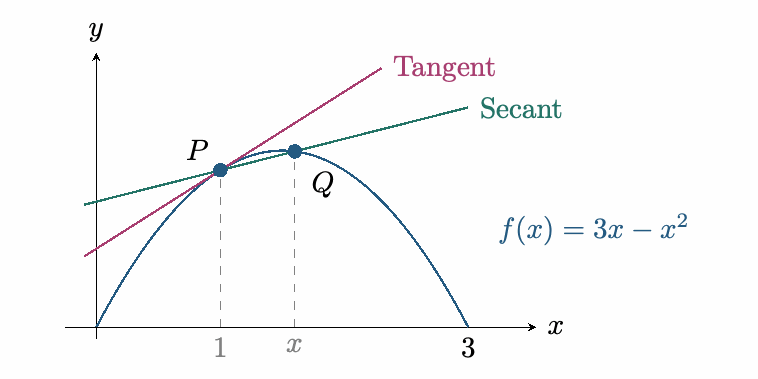
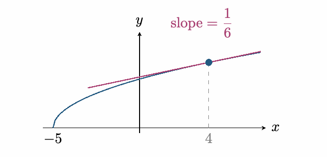
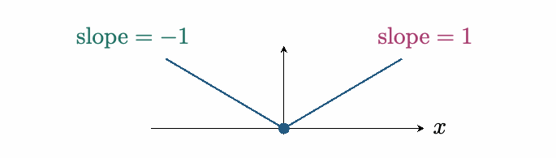
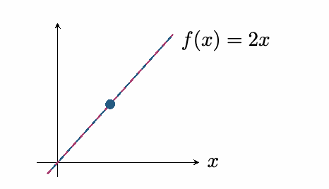

::: {.source-note}
[Lecture PDF · October 12, 2026](../downloads/october-12-derivatives-class-notes.pdf)
:::

## Instantaneous velocity and tangent lines

**Newton's question.** How do we compute instantaneous velocity from position?

Suppose a ball's position is $f(x)=3x-x^2$. What is its velocity at $x=1$?
We need the slope of the tangent line. Approximate it using secant lines.

{fig-alt="The parabola f(x)=3x−x² with a tangent at P=(1,2) and a secant through P and Q; Q approaches P as x approaches 1." width=390}

The secant slope is the *difference quotient*:

$$
\frac{\Delta y}{\Delta x}=\frac{f(x)-f(1)}{x-1}.
$$

Taking its limit gives the tangent slope:

$$
\begin{aligned}
\lim_{x\to1}\frac{f(x)-f(1)}{x-1}
 &=\lim_{x\to1}\frac{3x-x^2-2}{x-1}\\
 &=\lim_{x\to1}\frac{-(x-2)(x-1)}{x-1}\\
 &=\lim_{x\to1}-(x-2)=1.
\end{aligned}
$$

Thus the instantaneous velocity at $x=1$ is $1$.

## The derivative at a point

::: {.statement}

**Definition**

The *derivative of $f$ at $a$*, read “$f$ prime at $a$,” is

$$
f'(a)=\lim_{x\to a}\frac{f(x)-f(a)}{x-a}
=\lim_{h\to0}\frac{f(a+h)-f(a)}{h},
$$

provided the limit exists as a finite number. The two forms agree by setting $h=x-a$.
We say $f$ is *differentiable at $a$* when $f'(a)$ exists.

:::

The number $f'(a)$ represents the slope of the tangent line to $f$ at $x=a$, or the instantaneous rate of change of $f$ there. The tangent line is the best linear approximation near that point.

## Computing derivatives from the definition

**Example 1.** For $f(x)=\sqrt{x+5}$, find $f'(4)$.  *Exam 1: 2b*

*Conjugate.* Since $f(4)=3$,

$$
\begin{aligned}
f'(4)
 &=\lim_{x\to4}\frac{\sqrt{x+5}-3}{x-4}\\
 &=\lim_{x\to4}\frac{(\sqrt{x+5}-3)(\sqrt{x+5}+3)}{(x-4)(\sqrt{x+5}+3)}\\
 &=\lim_{x\to4}\frac{x+5-9}{(x-4)(\sqrt{x+5}+3)}\\
 &=\lim_{x\to4}\frac1{\sqrt{x+5}+3}=\frac16.
\end{aligned}
$$

{fig-alt="The graph of f(x)=√(x+5) and its tangent at (4,3), with slope 1/6." width=338}

**Example 2.** For $f(x)=|x|$, find $f'(0)$.

*Case method.*

$$
f'(0)=\lim_{h\to0}\frac{|0+h|-|0|}{h}
=\lim_{h\to0}\frac{|h|}{h},
$$

if this limit exists. Check each side:

$$
\begin{aligned}
L^-&=\lim_{h\to0^-}\frac{-h}{h}=-1,\\[3pt]
L^+&=\lim_{h\to0^+}\frac{h}{h}=1.
\end{aligned}
$$

Since $L^-\ne L^+$, the limit does not exist. Therefore $f'(0)$ does not exist.

{fig-alt="The graph of |x| has a corner at the origin: the left slope is −1 and the right slope is 1." width=352}

There is no single tangent slope at the corner.

**Example 3.** For $f(x)=mx+b$, find $f'(2)$.

*Difference quotient.*

$$
\begin{aligned}
f'(2)
 &=\lim_{x\to2}\frac{f(x)-f(2)}{x-2}\\
 &=\lim_{x\to2}\frac{(mx+b)-(2m+b)}{x-2}\\
 &=\lim_{x\to2}\frac{m(x-2)}{x-2}=m.
\end{aligned}
$$

The choice $a=2$ does not matter: $f'(a)=m$ for every $a$. A line is its own tangent line.

{fig-alt="The line f(x)=2x coincides with its tangent line." width=240}
