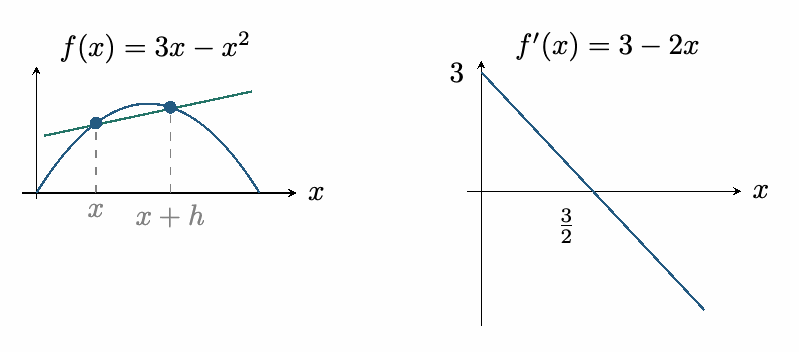
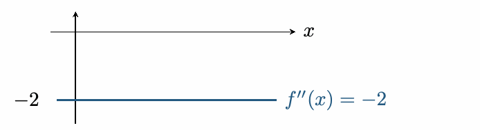
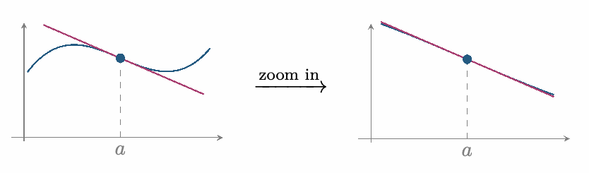

::: {.source-note}
[Lecture PDF · October 12, 2026](../downloads/october-12-derivatives-class-notes.pdf)
:::

## Section 3.2: the derivative function

::: {.statement}

**Definition**

For a function $f$, the *derivative function* $f'$ is defined by

$$
f'(x)=\lim_{h\to0}\frac{f(x+h)-f(x)}{h}.
$$

Its domain consists of the points $x$ where this limit exists as a finite number.

:::

**Example.** Let $f(x)=3x-x^2$. Then

$$
\begin{aligned}
f'(x)
 &=\lim_{h\to0}\frac{[3(x+h)-(x+h)^2]-[3x-x^2]}{h}\\
 &=\lim_{h\to0}\frac{3x+3h-x^2-2xh-h^2-3x+x^2}{h}\\
 &=\lim_{h\to0}\frac{h(3-2x-h)}{h}\\
 &=\lim_{h\to0}(3-2x-h)=3-2x.
\end{aligned}
$$

{fig-alt="Side-by-side graphs of f(x)=3x−x², with a secant between x and x+h, and f′(x)=3−2x, crossing the axes at 3 and 3/2." width=386}

## Higher-order derivatives

Continue with $f(x)=3x-x^2$ and $f'(x)=3-2x$.

**Second derivative.** The derivative of $f'$ is $f''$, read “$f$ double prime.”

$$
\begin{aligned}
f''(x)
 &=\lim_{h\to0}\frac{f'(x+h)-f'(x)}{h}\\
 &=\lim_{h\to0}\frac{[3-2(x+h)]-[3-2x]}{h}\\
 &=\lim_{h\to0}\frac{-2h}{h}=-2.
\end{aligned}
$$

{fig-alt="The second derivative f″(x)=−2 is a horizontal line below the x-axis." width=357}

**Third derivative.** The derivative of $f''$ is $f'''$, read “$f$ triple prime.”

$$
\begin{aligned}
f'''(x)
 &=\lim_{h\to0}\frac{f''(x+h)-f''(x)}{h}\\
 &=\lim_{h\to0}\frac{-2-(-2)}{h}
 =\lim_{h\to0}\frac0h=0.
\end{aligned}
$$

The fourth derivative is also zero. In fact,

$$
f^{(n)}(x)=0\qquad\text{for every integer }n\ge3.
$$

## Notation

**1. Prime/Newton notation.** For the $n$th derivative, write

$$
f^{(n)}(x)=f^{\overbrace{\prime\cdots\prime}^{n\text{ primes}}}(x).
$$

In particular, $f^{(2)}=f''$ and $f^{(3)}=f'''$.

**2. Leibniz notation.** Write

$$
\frac{df}{dx}=f'(x).
$$

At $x=a$,

$$
\frac{df}{dx}(a)
=\left.\frac{df}{dx}\right|_{x=a}
=f'(a).
$$

The symbol $\dfrac{d}{dx}$ is the *derivative operator*.

## Differentiability implies continuity

::: {.statement}

**Theorem**

Let $a$ be in the domain of $f$. If $f'(a)$ exists, then $f$ is continuous at $a$.

:::

**Geometric idea.** When we zoom in near a differentiable point, the graph is approximated by its tangent line, which is continuous at $a$.

{fig-alt="Zooming in near a differentiable point a makes the curve resemble its tangent line; the original and enlarged views are shown side by side." width=429}

Proof

We want to show $\displaystyle\lim_{x\to a}f(x)=f(a)$. For $x\ne a$,

$$
f(x)=(x-a)\frac{f(x)-f(a)}{x-a}+f(a).
$$

Since the difference quotient has the finite limit $f'(a)$, the limit laws give

$$
\begin{aligned}
\lim_{x\to a}f(x)
 &=\left(\lim_{x\to a}(x-a)\right)
   \left(\lim_{x\to a}\frac{f(x)-f(a)}{x-a}\right)+f(a)\\
 &=0\cdot f'(a)+f(a)=f(a).
\end{aligned}
$$

Therefore $f$ is continuous at $a$.

::: {.statement}

**Corollary**

If $f'(a)$ exists, then the tangent line at $(a,f(a))$ is

$$
y-f(a)=f'(a)(x-a),
\qquad\text{or}\qquad y=f'(a)(x-a)+f(a).
$$

:::

Proof

Use point-slope form with slope $f'(a)$ and point $(a,f(a))$.

## The converse is false

Continuity does not imply differentiability.

**Example.** The function $f(x)=|x|$ is continuous at $0$, since
$\displaystyle\lim_{x\to0}|x|=0=f(0)$. Yet $f'(0)$ does not exist:

$$
\lim_{h\to0^-}\frac{|h|}{h}=-1
\qquad\text{and}\qquad
\lim_{h\to0^+}\frac{|h|}{h}=1.
$$

## Practice

**1.** Find the tangent line to $f(x)=\sqrt{x+6}$ at $x=3$.

Show solution

*Conjugate.* Since $f(3)=3$,

$$
\begin{aligned}
f'(3)
 &=\lim_{x\to3}\frac{\sqrt{x+6}-3}{x-3}\\
 &=\lim_{x\to3}\frac{(\sqrt{x+6}-3)(\sqrt{x+6}+3)}{(x-3)(\sqrt{x+6}+3)}\\
 &=\lim_{x\to3}\frac{x-3}{(x-3)(\sqrt{x+6}+3)}\\
 &=\lim_{x\to3}\frac1{\sqrt{x+6}+3}=\frac16.
\end{aligned}
$$

Thus the tangent line is

$$
y-3=\frac16(x-3),\qquad\text{or}\qquad y=\frac{x}{6}+\frac52.
$$

**2.** Identify $f$ and $a$ in the limit below, and find $f'(a)$:

$$
\lim_{h\to0}\frac{(1+h)^2-1}{h}.
$$

Show solution

*Match the definition.* Take $f(x)=x^2$ and $a=1$. Then $f(1+h)=(1+h)^2$ and $f(1)=1$, so

$$
f'(1)=\lim_{h\to0}\frac{1+2h+h^2-1}{h}
=\lim_{h\to0}(2+h)=2.
$$

**3.** Is $f$ differentiable at $x=-1$? Prove your answer rigorously.

$$
f(x)=\begin{cases}(x+1)^2,&x\ne-1,\\1,&x=-1.\end{cases}
$$

Show solution

*(a) Use continuity.* We have $\displaystyle\lim_{x\to-1}f(x)=0$, but $f(-1)=1$. Thus $f$ is discontinuous at $-1$ and therefore is not differentiable there.

*(b) Use the definition.* For $x\ne-1$,

$$
\frac{f(x)-f(-1)}{x+1}
=\frac{(x+1)^2-1}{x+1}
=(x+1)-\frac1{x+1}.
$$

The one-sided limits of this quotient are

$$
\lim_{x\to-1^-}\left((x+1)-\frac1{x+1}\right)=+\infty,
\qquad
\lim_{x\to-1^+}\left((x+1)-\frac1{x+1}\right)=-\infty.
$$

Hence $f'(-1)$ does not exist.

