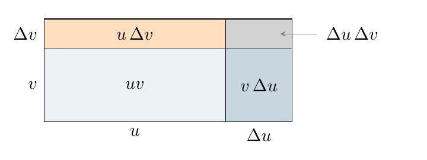
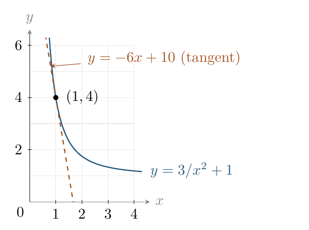

::: {.source-note}
[Lecture PDF · October 14, 2026](../downloads/october-14-differentiation-rules.pdf)
:::

## Our class example: $f(x)=3x-x^2$

Recall the calculation we did together:

$$
\begin{aligned}
f'(x)&=\lim_{h\to0}\frac{[3(x+h)-(x+h)^2]-[3x-x^2]}h\\
&=\lim_{h\to0}(3-2x-h)=3-2x.
\end{aligned}
$$

**Question.** Could we obtain $3-2x$ directly from the terms $3x$ and $-x^2$?
The limit laws let us build a limit from simpler limits. We want rules that
let us build a derivative from simpler derivatives.

### Section 3.3: the rules we will use

::: {.statement}

**Theorem (Differentiation rules)**

Suppose $f$ and $g$ are differentiable at $x$. Let $c$ be a real constant
and $n$ any real number. Then

$$
\begin{array}{@{}ll@{}}
\text{Constant:}&\displaystyle\frac{d}{dx}(c)=0.\\[8pt]
\text{Identity:}&\displaystyle\frac{d}{dx}(x)=1.\\[8pt]
\text{Sum:}&\displaystyle\frac{d}{dx}[f(x)+g(x)]=f'(x)+g'(x).\\[8pt]
\text{Difference:}&\displaystyle\frac{d}{dx}[f(x)-g(x)]=f'(x)-g'(x).\\[8pt]
\text{Scalar multiple:}&\displaystyle\frac{d}{dx}[cf(x)]=cf'(x).\\[8pt]
\text{Power:}&\displaystyle\frac{d}{dx}(x^n)=nx^{n-1}.\\[8pt]
\text{Product:}&\displaystyle\frac{d}{dx}[f(x)g(x)]=f'(x)g(x)+f(x)g'(x).\\[8pt]
\text{Quotient:}&\displaystyle\frac{d}{dx}\left[\frac{f(x)}{g(x)}\right]
=\frac{g(x)f'(x)-f(x)g'(x)}{[g(x)]^2},\quad g(x)\ne0.
\end{array}
$$

The power rule includes negative and fractional exponents. It holds for
$x>0$ for every real $n$, and wherever both sides are defined for other inputs.
For $n=0$, use the constant rule.

:::

**Compare with the limit laws.** Differentiation distributes over sums
and constant multiples. Products and quotients have different formulas:
$(fg)'$ is generally not $f'g'$, and $(f/g)'$ is generally not $f'/g'$.
The power rule above concerns $x^n$; powers of a function will be treated
with the chain rule.

**Our route.** Use and explain the rules; combine them to compute derivatives;
then use derivatives with tangent lines.

## Sums, constant multiples, and powers

**Example 1.** Use the differentiation rules to recover the derivative.

$$
\begin{aligned}
\frac{d}{dx}(3x-x^2)
&=3\frac{d}{dx}(x)-\frac{d}{dx}(x^2)\\
&=3(1)-2x=3-2x.
\end{aligned}
$$

We used the difference, scalar-multiple, identity, and power rules.
Why are we allowed to separate the calculation this way?

### Why sums and constant multiples work

For differentiable $u,v$ and a constant $c$,

$$
\begin{aligned}
\frac{d}{dx}[cu(x)+v(x)]
&=\lim_{h\to0}\frac{c[u(x+h)-u(x)]+[v(x+h)-v(x)]}{h}\\
&=c\lim_{h\to0}\frac{u(x+h)-u(x)}h
+\lim_{h\to0}\frac{v(x+h)-v(x)}h\\
&=cu'(x)+v'(x).
\end{aligned}
$$

The scalar-multiple and sum limit laws justify the second equality. Replacing
$v$ by $-v$ gives the difference rule. Also,

$$
\frac{d}{dx}(c)=\lim_{h\to0}\frac{c-c}{h}=0,\qquad
\frac{d}{dx}(x)=\lim_{h\to0}\frac{x+h-x}{h}=1.
$$

**Example 2.** Differentiate $p(x)=4x^3-2x+7$.

*Use the same rules.*

$$
p'(x)=4(3x^2)-2(1)+0=12x^2-2.
$$

The constant $7$ disappears; the derivative of $-2x$ is $-2$.

## Products: one derivative at a time

Our motivating function can also be written $f(x)=x(3-x)$.
Multiplying the derivatives of the two factors would give $1(-1)=-1$,
but we already know $f'(x)=3-2x$. That guess fails.

**Example 3.** Apply the product rule to $f(x)=x(3-x)$:

$$
f'(x)=1(3-x)+x(-1)=3-2x.
$$

Each term differentiates one factor and keeps the other in place.

### Why are there two terms?

For differentiable factors $u(x)$ and $v(x)$, let

$$
\Delta u=u(x+h)-u(x),\qquad \Delta v=v(x+h)-v(x).
$$

In the following algebra, $u$ and $v$ denote their values at $x$. Then

$$
\Delta(uv)=(u+\Delta u)(v+\Delta v)-uv
=v\,\Delta u+u\,\Delta v+\Delta u\,\Delta v.
$$

For positive lengths and changes, the three added regions show this change in area.
The diagram illustrates the general product rule; it is not a graph of $x(3-x)$.

{fig-alt="Area diagram: the original rectangle has area uv. Increasing its sides by delta u and delta v adds regions v delta u, u delta v, and delta u delta v." width=430}

The algebra also holds for changes of either sign. Divide by $h$:

$$
\frac{\Delta(uv)}h=v\frac{\Delta u}h+u\frac{\Delta v}h
+\Delta u\frac{\Delta v}h
\xrightarrow[h\to0]{}vu'(x)+uv'(x).
$$

The last term tends to zero because differentiability implies continuity:
$\Delta u\to0$, while $\Delta v/h\to v'(x)$ is finite. The left side tends to
$(uv)'(x)$, giving the product rule.

**Example 4.** Differentiate $y=(x-1)(3x^2+2)$.

*Product rule.*

$$
\begin{aligned}
y'&=1(3x^2+2)+(x-1)(6x)\\
&=9x^2-6x+2.
\end{aligned}
$$

Expanding $y=3x^3-3x^2+2x-2$ first gives the same derivative.

## Quotients and negative powers

**Example 5.** Differentiate $y=(x^2+9)/(x^2-1)$.

*Quotient rule.*

$$
\begin{aligned}
y'&=\frac{(x^2-1)(2x)-(x^2+9)(2x)}{(x^2-1)^2}\\
&=\frac{2x^3-2x-2x^3-18x}{(x^2-1)^2}
=\frac{-20x}{(x^2-1)^2},\qquad x\ne\pm1.
\end{aligned}
$$

**Example 6.** Differentiate $f(x)=x^4+3/x$.

*Rewrite as powers.*

For $x\ne0$,

$$
f(x)=x^4+3x^{-1}\quad\Longrightarrow\quad
f'(x)=4x^3-3x^{-2}=4x^3-\frac3{x^2}.
$$

A fraction may be easier to differentiate after rewriting it. The exponent
decreases by one: $-1-1=-2$.

## Combining rules and differentiating again

First look for useful algebra. If a product or quotient remains, identify
its two parts and apply the appropriate rule. Simplify the derivative last.

**Example 7.** Differentiate $y=x^2(3/x^2+4/x^3)$.

*Simplify first.*

$$
y=3+\frac4x\quad\Longrightarrow\quad y'=-\frac4{x^2}.
$$

Using the product rule gives the same result, with more cancellation:

$$
y'=2x(3x^{-2}+4x^{-3})+x^2(-6x^{-3}-12x^{-4})=-4x^{-2}.
$$

**Example 8.** Differentiate $y=2x\left(5x^3+\dfrac7{x+2}\right)$.

*A product containing a quotient.*

First find the derivative inside:

$$
\frac{d}{dx}\left(\frac7{x+2}\right)
=\frac{(x+2)(0)-7(1)}{(x+2)^2}=-\frac7{(x+2)^2}.
$$

Now apply the product rule to the entire expression:

$$
\begin{aligned}
y'&=2\left(5x^3+\frac7{x+2}\right)
+2x\left(15x^2-\frac7{(x+2)^2}\right)\\
&=40x^3+\frac{14(x+2)-14x}{(x+2)^2}
=40x^3+\frac{28}{(x+2)^2},\qquad x\ne-2.
\end{aligned}
$$

Write a correct derivative before trying to simplify it.

### A second derivative is a derivative of a derivative

If $y=f(x)$, then $y''=f''(x)=\dfrac{d}{dx}[f'(x)]$, when this derivative exists.
Differentiate the first derivative; do not square it.

**Example 9.** Differentiate $y=(3x^3-x+2)/x^2$ twice.

*Divide each term by the denominator.*

$$
\begin{aligned}
y&=3x-x^{-1}+2x^{-2},\\
y'&=3+x^{-2}-4x^{-3},\\
y''&=-2x^{-3}+12x^{-4},\qquad x\ne0.
\end{aligned}
$$

## Tangent lines and prescribed slopes

Once $f'(x)$ is known, a tangent problem becomes a point-and-slope problem:

$$
y-f(a)=f'(a)(x-a).
$$

**Example 10.** Find the tangent to $f(x)=3/x^2+1$ at $x=1$.

*Point, slope, line.*

$$
f(1)=4,\qquad f'(x)=-6x^{-3},\qquad f'(1)=-6.
$$

Hence $y-4=-6(x-1)$, or $y=-6x+10$.
The graph shows the positive branch and its tangent. At $(1,4)$ they have
both the same value and the same slope; sharing a point alone is not enough.

{fig-alt="The positive branch of y = 3/x squared + 1 and its tangent y = -6x + 10 meet at (1, 4) with the same slope." width=370}

**Example 11.** For $f(x)=x^3-3x^2+2$, find all points where the tangent
(a) is horizontal and (b) has slope $9$.

*Solve for the input, then find the point.*

 First,

$$
f'(x)=3x^2-6x.
$$

**(a)** A horizontal tangent has slope $0$:

$$
3x(x-2)=0\quad\Longrightarrow\quad x=0,2.
$$

Since $f(0)=2$ and $f(2)=-2$, the points are $(0,2)$ and $(2,-2)$.

**(b)** Set $f'(x)=9$, not $f(x)=9$:

$$
3x^2-6x=9\quad\Longrightarrow\quad(x-3)(x+1)=0.
$$

The inputs are $x=-1,3$. Evaluating the original function gives the points
$(-1,-2)$ and $(3,2)$. A slope condition specifies $f'$, while coordinates require $f$.

### Section 3.3 recap

Choose the form, apply the rule, then simplify. For tangent lines, find
both the point and the slope.
