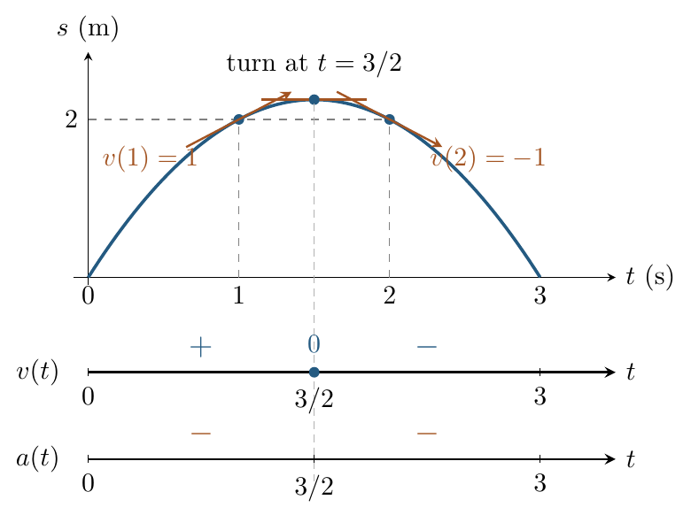
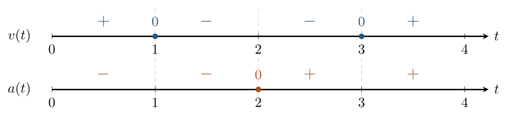
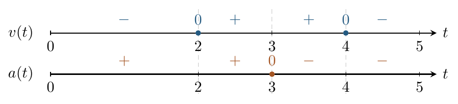

::: {.source-note}
[Lecture PDF · October 16, 2026](../downloads/october-16-rates-and-trig-class-notes.pdf)
:::

## 1. From derivatives to motion

Revisit $s(t)=3t-t^2$, $0\le t\le3$, with position in meters and time in seconds.
What do its derivatives tell us about the motion?

$$
\underbrace{v(t)=s'(t)=3-2t}_{\text{velocity (m/s)}},\qquad
\underbrace{a(t)=v'(t)=-2}_{\text{acceleration (m/s}^2\text{)}}.
$$

The sign of velocity gives direction. Speed is $|v(t)|$.

{fig-alt="Position s(t)=3t−t² rises to a turning point at t=3/2, then falls. Velocity is positive before 3/2, zero there, and negative afterward; acceleration is negative throughout." width=430}

On $(0,3/2)$, $v>0$ and $a<0$: the particle moves in the positive direction
and slows down. At $t=3/2$, it is at rest and reverses direction.
On $(3/2,3)$, $v<0$ and $a<0$: it moves in the negative direction and speeds up.

**Compare the signs:** matching signs of $v$ and $a$ mean speeding up;
opposite signs mean slowing down. Negative acceleration alone does not mean slowing down.

**Example 1.** A particle has position

$$
s(t)=t^3-6t^2+9t+2,\qquad 0\le t\le4.
$$

Find when it is at rest, its direction of motion, and when its speed increases.

$$
v(t)=3t^2-12t+9=3(t-1)(t-3),\qquad a(t)=6t-12=6(t-2).
$$

The particle is at rest at $t=1,3$. To discuss speed, split the time interval
at the zeros of *both* velocity and acceleration:

{fig-alt="Aligned sign graphs on 0≤t≤4. Velocity has signs +, −, −, + across the intervals divided by 1, 2, and 3, with zeros at 1 and 3. Acceleration has signs −, −, +, + and is zero at 2." width=600}

Use the factored expressions or a test time to find each sign. From the velocity
sign graph, motion is positive on $(0,1)$ and $(3,4)$ and negative on $(1,3)$.
Comparing the two graphs, the particle speeds up on $(1,2)$ and $(3,4)$ and
slows down on $(0,1)$ and $(2,3)$.

On $(1,2)$, velocity is negative and becoming more negative, so speed increases.
At $t=2$, acceleration changes sign but velocity does not: speed changes from
increasing to decreasing without a change in direction.

## 2. Read the event before substituting

A question may specify a time, a position, or an event such as impact.
The input to a velocity function $v(t)$ is always time. Find that time first.

**Example 2.** A ball has height $H(t)=96-16t-16t^2$ feet until it hits the ground,
with $t$ measured in seconds. Find the impact time, impact velocity, and impact speed.

Ground level means height zero:

$$
96-16t-16t^2=-16(t+3)(t-2)=0.
$$

The roots are $-3$ and $2$. We reject the negative time, so impact occurs
at $t=2$ s and the flight model applies on $0\le t\le2$.

$$
v(t)=H'(t)=-16-32t,\qquad a(t)=-32.
$$

Just before impact, the velocity is $v(2)=-80$ ft/s; the speed is
$|v(2)|=80$ ft/s. The negative sign gives the downward direction.
The polynomial can be evaluated after $t=2$, but those values do not describe
this flight after contact with the ground.

**Example 3.** A car's position is $s(t)=t^2-2t-3$ feet, $t\ge0$.
Find its velocity when (a) $s=0$ and (b) $s=5$.

*Solve for time before evaluating velocity.*

First, $v(t)=s'(t)=2t-2$ ft/s. Now solve each position condition:

$$
\begin{array}{lll}
\text{(a)}&t^2-2t-3=(t-3)(t+1)=0 &\Longrightarrow t=3,\\[5pt]
&&v(3)=4\text{ ft/s};\\[9pt]
\text{(b)}&t^2-2t-3=5\Longleftrightarrow(t-4)(t+2)=0
&\Longrightarrow t=4,\\[5pt]
&&v(4)=6\text{ ft/s}.
\end{array}
$$

In each case the other root is outside $t\ge0$. Substituting $5$ directly
into $v(t)$ would find velocity at five seconds, not at position five feet.
In other models, more than one admissible time can satisfy a position condition.

## Practice

Include units in your answer.

**1.** A particle has position

$$
s(t)=-t^3+9t^2-24t+5,\qquad 0\le t\le5,
$$

with position in meters and time in seconds. Use sign graphs for velocity and
acceleration to find when the particle is at rest, its direction of motion,
and when it speeds up or slows down.

Show solution

Factor the velocity and mark the zeros of both derivatives:

$$
v(t)=-3t^2+18t-24=-3(t-2)(t-4),\qquad a(t)=18-6t=-6(t-3).
$$

Velocity is zero at $t=2,4$; acceleration is zero at $t=3$.

{fig-alt="Practice 1: velocity has signs −, +, +, − on intervals divided by 2, 3, and 4, with zeros at 2 and 4. Acceleration has signs +, +, −, −, with a zero at 3." width=500}

At rest at $t=2,4$. Motion is in the positive direction on $(2,4)$ and
in the negative direction on $(0,2)$ and $(4,5)$. Matching signs: speeding up
on $(2,3)$ and $(4,5)$. Opposite signs: slowing down on $(0,2)$ and $(3,4)$.

