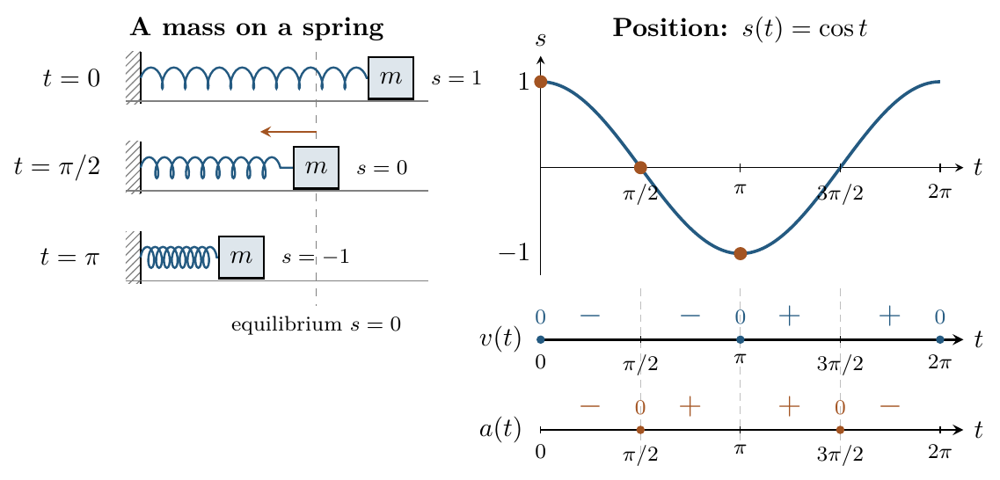

::: {.source-note}
[Lecture PDF · October 16, 2026](../downloads/october-16-rates-and-trig-class-notes.pdf)
:::

## 3. Derivatives of trigonometric functions

A mass on a spring has position $s(t)=\cos t$, measured in meters from
equilibrium, with $t$ in seconds. Consider one cycle, $0\le t\le2\pi$.
Using the trigonometric derivatives below,

$$
v(t)=s'(t)=-\sin t,\qquad a(t)=v'(t)=-\cos t.
$$

{fig-alt="A spring and mass at t=0, π/2, and π show positions 1, 0, and −1 relative to equilibrium. Alongside, s(t)=cos t and aligned sign graphs cover one cycle. Velocity has signs −, −, +, + on the four quarter cycles; acceleration has signs −, +, +, −." width=630}

The mass moves left on $(0,\pi)$ and right on $(\pi,2\pi)$.
Matching signs give speeding up on $(0,\pi/2)$ and $(\pi,3\pi/2)$;
opposite signs give slowing down on $(\pi/2,\pi)$ and $(3\pi/2,2\pi)$.
It is at rest at $t=0,\pi,2\pi$ and moves fastest as it passes equilibrium.

## Trigonometric notation we will use

Angles are measured in **radians**; one full turn is $2\pi$ radians.
On the unit circle, the point at angle $x$ has coordinates $(\cos x,\sin x)$.
For a calculator or graphing tool, select radian mode. We use

$$
\tan x=\frac{\sin x}{\cos x},\quad
\cot x=\frac{\cos x}{\sin x},\quad
\sec x=\frac1{\cos x},\quad
\csc x=\frac1{\sin x}.
$$

The symbols $\sec$ and $\csc$ denote reciprocals, not inverse functions.
A square such as $\sin^2x$ means $(\sin x)^2$.

::: {.statement}

**Theorem (Trigonometric derivative formulas)**

For angles measured in radians, on the domain of each function,

$$
\begin{array}{ll}
\displaystyle\frac{d}{dx}(\sin x)=\cos x,
&\displaystyle\frac{d}{dx}(\cos x)=-\sin x,\\[10pt]
\displaystyle\frac{d}{dx}(\tan x)=\sec^2x,
&\displaystyle\frac{d}{dx}(\cot x)=-\csc^2x,\\[10pt]
\displaystyle\frac{d}{dx}(\sec x)=\sec x\tan x,
&\displaystyle\frac{d}{dx}(\csc x)=-\csc x\cot x.
\end{array}
$$

The functions $\tan,\sec$ require $\cos x\ne0$; $\cot,\csc$ require
$\sin x\ne0$. Sine and cosine are defined for every real $x$.

:::

The sine and cosine formulas follow from the limit definition using the
angle-addition identities. We take those two formulas as our starting facts
here; the quotient rule will explain the other four.

**Example 4.** Differentiate $G(x)=3\sin x-x^2$.

$$
\begin{aligned}
G'(x)&=3\frac{d}{dx}(\sin x)-\frac{d}{dx}(x^2)=3\cos x-2x,\\
G''(x)&=3(-\sin x)-2=-3\sin x-2.
\end{aligned}
$$

The difference and scalar-multiple rules still apply. Note the minus sign in $(\cos x)'$.

## Choose the rule from the structure

**Example 5.** Differentiate $y=2x^2-\sec x$ and $z=2\csc x+3/x$.

$$
\begin{aligned}
y'&=4x-\sec x\tan x,\\
z'&=-2\csc x\cot x-\frac3{x^2}.
\end{aligned}
$$

For $y$, require $\cos x\ne0$. For $z$, require $\sin x\ne0$ and $x\ne0$.
The minus sign in $(\csc x)'$ is part of the formula.

**Example 6.** Differentiate $y=x^3\cot x$.

$$
\begin{aligned}
y'&=\frac{d}{dx}(x^3)\cot x+x^3\frac{d}{dx}(\cot x)\\
&=3x^2\cot x+x^3(-\csc^2x)\\
&=3x^2\cot x-x^3\csc^2x,\qquad\sin x\ne0.
\end{aligned}
$$

The cotangent factor stays in the first term and is differentiated in the second.

**Example 7.** Differentiate $z=\sin x\tan x$.

$$
z'=\cos x\tan x+\sin x\sec^2x,\qquad\cos x\ne0.
$$

This is a complete answer. The product rule does not require an identity to
simplify the result.

**Example 8.** Differentiate $y=\dfrac{\sec x}{x}$.

$$
y'=\frac{x(\sec x\tan x)-(\sec x)(1)}{x^2}
=\frac{x\sec x\tan x-\sec x}{x^2}.
$$

The original domain requires $x\ne0$ and $\cos x\ne0$.

## Choose the structure before simplifying

For a sum, differentiate term by term. For a product, write both terms.
For a quotient, preserve the numerator subtraction and square the denominator.
Identify the structure first, then look up the basic derivative you need.

## Using quotients to explain the new formulas

We will use the identity $\sin^2x+\cos^2x=1$.

**Example 9.** Derive the tangent formula from $\tan x=\sin x/\cos x$.

$$
\begin{aligned}
\frac{d}{dx}(\tan x)
&=\frac{(\cos x)(\cos x)-(\sin x)(-\sin x)}{\cos^2x}\\
&=\frac{\cos^2x+\sin^2x}{\cos^2x}
=\frac1{\cos^2x}=\sec^2x.
\end{aligned}
$$

For cotangent, reverse the roles of sine and cosine:

$$
\frac{d}{dx}(\cot x)
=\frac{(\sin x)(-\sin x)-(\cos x)(\cos x)}{\sin^2x}
=-\frac1{\sin^2x}=-\csc^2x.
$$

The sign follows from the numerator. These calculations apply on the
original domains of tangent and cotangent.

**Reciprocals use the same rule.** For example,

$$
\frac{d}{dx}(\sec x)
=\frac{(\cos x)(0)-1(-\sin x)}{\cos^2x}
=\frac1{\cos x}\frac{\sin x}{\cos x}=\sec x\tan x.
$$

**Example 10.** Differentiate $y=\dfrac{\tan x}{2-\sec x}$.

*Keep track of the two minus signs.*

Since $(2-\sec x)'=-\sec x\tan x$, the quotient rule gives

$$
\begin{aligned}
y'&=\frac{(2-\sec x)\sec^2x-(\tan x)(-\sec x\tan x)}{(2-\sec x)^2}\\
&=\frac{(2-\sec x)\sec^2x+\sec x\tan^2x}{(2-\sec x)^2}.
\end{aligned}
$$

This form is already correct. To simplify, divide
$\sin^2x+\cos^2x=1$ by $\cos^2x$:

$$
\tan^2x+1=\sec^2x\quad\Longrightarrow\quad\tan^2x=\sec^2x-1.
$$

Consequently,

$$
\begin{aligned}
(2-\sec x)\sec^2x+\sec x\tan^2x
&=2\sec^2x-\sec^3x+\sec x(\sec^2x-1)\\
&=2\sec^2x-\sec x.
\end{aligned}
$$

Thus $y'=(2\sec^2x-\sec x)/(2-\sec x)^2$, still requiring
$\cos x\ne0$ and $\sec x\ne2$.

## Second derivatives and tangent slopes

**Example 11.** Find $y'$ and $y''$ if $y=2\sin x\cos x$.

$$
\begin{aligned}
y'&=2\bigl[(\cos x)(\cos x)+(\sin x)(-\sin x)\bigr]\\
&=2\cos^2x-2\sin^2x.
\end{aligned}
$$

To differentiate again without a new rule, write each square as a product:

$$
\begin{aligned}
y''&=2\bigl[(-\sin x)\cos x+\cos x(-\sin x)\bigr]\\
&\quad-2\bigl[(\cos x)\sin x+\sin x(\cos x)\bigr]\\
&=-8\sin x\cos x.
\end{aligned}
$$

Each product contributes two terms. We have not needed a double-angle formula.

**Example 12.** Find the tangent to $f(x)=-2\sin x$ at $x=0$.

Using $\sin0=0$ and $\cos0=1$,

$$
f(0)=0,\qquad f'(x)=-2\cos x,\qquad f'(0)=-2.
$$

The tangent line is $y=-2x$. Plot the function and line in radian mode and
zoom near $(0,0)$ to check the result.

**Example 13.** Find every $x$ in $0<x<2\pi$ where $f(x)=x-4\cos x$ has slope $3$.

*Turn the slope condition into an equation.*

$$
f'(x)=1+4\sin x,\qquad
1+4\sin x=3\quad\Longrightarrow\quad\sin x=\frac12.
$$

Use these trig facts: sine equals $1/2$ at $\pi/6$ and $5\pi/6$,
and these are its only two such inputs between $0$ and $2\pi$.
Thus $x=\pi/6,5\pi/6$. Both satisfy the stated interval. The method is:
write $f'(x)=m$, solve the resulting equation, and keep every admissible solution.

## Practice

State the rule you use.

**2.** Find $y'$ and $y''$ if $y=x\sin x$.

Show solution

Apply the product rule, then differentiate again:

$$
y'=\sin x+x\cos x,\qquad
 y''=\cos x+\cos x-x\sin x=2\cos x-x\sin x.
$$

**3.** Differentiate $y=\dfrac{\sin x}{1+\cos x}$ and simplify.

Show solution

Use the quotient rule and $\sin^2x+\cos^2x=1$:

$$
\begin{aligned}
y'&=\frac{(1+\cos x)\cos x-(\sin x)(-\sin x)}{(1+\cos x)^2}\\
&=\frac{\cos x+\cos^2x+\sin^2x}{(1+\cos x)^2}
=\frac1{1+\cos x},\qquad 1+\cos x\ne0.
\end{aligned}
$$

