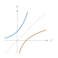
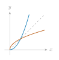
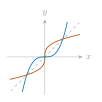
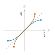
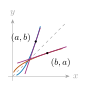
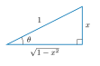

::: {.source-note}
[Lecture PDF · October 21, 2026](../downloads/october-21-inverse-implicit-class-notes.pdf)
:::

## Inverse functions

**Question.** How do we find $\dfrac{d}{dx}f^{-1}(x)$?

An inverse function *undoes* the original function: 

$$
f^{-1}(f(x))=x,\qquad f(f^{-1}(y))=y.
$$

 Here $f$ must be one-to-one on the domain being used. The notation $f^{-1}$ means the inverse function, not the reciprocal $1/f$.

The graphs of $f$ and $f^{-1}$ are reflections across $y=x$. The domain and range exchange roles. The dashed line in each sketch is $y=x$.

**Exponential and logarithm** 

$$
f(x)=e^x,\quad f^{-1}(x)=\ln x.
$$

{fig-alt="Exponential and logarithm graphs reflected across y=x." width=280}

**Square and square root** 

$$
f(x)=x^2\ (x\geq0),\quad f^{-1}(x)=\sqrt{x}.
$$

{fig-alt="The nonnegative branch of y=x squared and its inverse square-root graph, reflected across y=x." width=260}

**Cube and cube root** 

$$
f(x)=x^3,\quad f^{-1}(x)=\sqrt[3]{x}.
$$

{fig-alt="The cubic and cube-root graphs reflected across y=x." width=260}

**Sine and inverse sine** 

$$
\begin{gathered}
f(x)=\sin x\quad(-\tfrac\pi2\leq x\leq\tfrac\pi2),\\
f^{-1}(x)=\sin^{-1}x=\arcsin x.
\end{gathered}
$$

{fig-alt="Sine restricted to minus pi/2 through pi/2 and inverse sine, with corresponding endpoints reflected across y=x." width=270}

## The inverse-function derivative

**Theorem.**

Suppose $f$ is one-to-one and continuous on an open interval containing $a$, is differentiable at $a$, and $f'(a)\ne0$. If $b=f(a)$, then $f^{-1}$ is differentiable at $b$, and 

$$
(f^{-1})'(b)=\frac{1}{f'(a)}=\frac{1}{f'(f^{-1}(b))}.
$$

**Proof.**

Let $b=f(a)$, so $a=f^{-1}(b)$. Apply the chain rule to 

$$
f^{-1}(f(x))=x:
$$

 

$$
(f^{-1})'(f(x))\,f'(x)=1.
$$

 At $x=a$, this gives $(f^{-1})'(b)\,f'(a)=1$. Since $f'(a)\ne0$, 

$$
(f^{-1})'(b)=\frac1{f'(a)}=\frac1{f'(f^{-1}(b))}.
$$

**Geometrically.** Reflection across $y=x$ interchanges rise and run. Tangent slopes at $(a,b)$ and $(b,a)$ are reciprocals: 

$$
m_{f^{-1}}=\frac{1}{m_f}.
$$

{fig-alt="Tangents to a function and its inverse at (a,b) and (b,a), with reciprocal slopes." width=280}

**Example 1.**

Suppose $f(2)=5$, $f'(2)=-3$, and $f$ satisfies the theorem's hypotheses. Compute $(f^{-1})'(5)$. 

$$
f^{-1}(5)=2,\qquad
(f^{-1})'(5)=\frac{1}{f'(f^{-1}(5))}=\frac1{f'(2)}=-\frac13.
$$

**Example 2.**

Let $f(x)=x^2$ for $x\geq0$. Since $f(2)=4$, 

$$
(f^{-1})'(4)=\frac1{f'(2)}=\frac1{2\cdot2}=\frac14.
$$

**Example 3.**

Let $f(x)=x^3$. Since $f(2)=8$, 

$$
(f^{-1})'(8)=\frac1{f'(2)}=\frac1{3\cdot2^2}=\frac1{12}.
$$

 *Check.* $f^{-1}(x)=x^{1/3}$, so $(f^{-1})'(8)=\tfrac13\,8^{-2/3}=\tfrac13\cdot\tfrac14=\tfrac1{12}$.

## Derivatives of inverse trigonometric functions

**Proposition.**

With the usual inverse-trigonometric branches, the following derivatives hold on the indicated open domains. Angles are measured in radians. 

$$
\begin{array}{rcll}
\text{(i)}\quad \dfrac{d}{dx}\sin^{-1}x&=&\dfrac1{\sqrt{1-x^2}},& |x|<1,\\[13pt]
\text{(ii)}\quad \dfrac{d}{dx}\cos^{-1}x&=&-\dfrac1{\sqrt{1-x^2}},& |x|<1,\\[13pt]
\text{(iii)}\quad \dfrac{d}{dx}\tan^{-1}x&=&\dfrac1{1+x^2},& x\in\mathbb R,\\[13pt]
\text{(iv)}\quad \dfrac{d}{dx}\csc^{-1}x&=&-\dfrac1{|x|\sqrt{x^2-1}},& |x|>1,\\[13pt]
\text{(v)}\quad \dfrac{d}{dx}\sec^{-1}x&=&\dfrac1{|x|\sqrt{x^2-1}},& |x|>1,\\[13pt]
\text{(vi)}\quad \dfrac{d}{dx}\cot^{-1}x&=&-\dfrac1{1+x^2},& x\in\mathbb R.
\end{array}
$$

Here $\cot^{-1}$ takes values in $(0,\pi)$, $\sec^{-1}$ in $[0,\pi]\setminus\{\pi/2\}$, and $\csc^{-1}$ in $[-\pi/2,\pi/2]\setminus\{0\}$.

**Proof of (i).**

Let $\theta=\sin^{-1}x$. Then $\sin\theta=x$ and $-\pi/2<\theta<\pi/2$. By the inverse-function derivative theorem, 

$$
\frac{d}{dx}\sin^{-1}x
=\frac1{\cos(\sin^{-1}x)}=\frac1{\cos\theta}.
$$

 To find $\cos\theta$, first draw a right triangle for $0<x<1$. Since $\sin\theta=x/1$, take the opposite side to be $x$ and the hypotenuse to be $1$.

{fig-alt="Right triangle with angle theta, opposite side x, hypotenuse 1, and adjacent side square root of 1 minus x squared." width=330}

The Pythagorean theorem gives the adjacent side $\sqrt{1-x^2}$, so 

$$
\cos\theta=\frac{\text{adjacent}}{\text{hypotenuse}}
=\frac{\sqrt{1-x^2}}{1}=\sqrt{1-x^2}.
$$

 This also holds for all $-1<x<1$: $\cos^2\theta=1-\sin^2\theta=1-x^2$, and $\cos\theta>0$ for $-\pi/2<\theta<\pi/2$. Therefore 

$$
\frac{d}{dx}\sin^{-1}x=\frac1{\sqrt{1-x^2}}.
$$

## Using inverse-trigonometric derivatives

**Example.** Find $\dfrac{d}{dx}\cos^{-1}\!\sqrt{2x}$.

**Chain rule.**

Differentiate the layers from outside inward: [inverse cosine]{.chain-first}, [square root]{.chain-second}, then [$2x$]{.chain-third}. 

$$
\begin{aligned}
\frac{d}{dx}\cos^{-1}\!\sqrt{2x}
&=\textcolor{#0072B2}{-\frac1{\sqrt{1-(\sqrt{2x})^2}}}\,
  \textcolor{#B44D00}{\frac{1}{2\sqrt{2x}}}\,\textcolor{#9C2B79}{2}\\[3pt]
&=-\frac1{\sqrt{1-2x}\sqrt{2x}}\\[3pt]
&=-\frac1{\sqrt{2x-4x^2}},\qquad 0<x<\frac12.
\end{aligned}
$$

 The function is defined for $0\leq x\leq\tfrac12$; the displayed derivative applies in the interior.

## Practice

**1.** Find $\dfrac{d}{dx}\bigl(\tan^{-1}\sqrt{x}\bigr)$. 

Show solution

$$
\begin{aligned}
\frac{d}{dx}\tan^{-1}\sqrt{x}
&=\textcolor{#0072B2}{\frac1{1+(\sqrt{x})^2}}\,
\textcolor{#B44D00}{\frac1{2\sqrt{x}}}\\[3pt]
&=\frac1{2\sqrt{x}(1+x)},\qquad x>0.
\end{aligned}
$$

**2.** Find $y'(2)$, where $x\cos y=2$.

Show solution

For the principal inverse-cosine branch, write 

$$
y=\cos^{-1}\!\left(\frac2x\right).
$$

 Near $x=2$, this branch has $x\geq2$. For $x>2$, 

$$
y'=\left(-\frac1{\sqrt{1-4/x^2}}\right)\left(-\frac2{x^2}\right)
=\frac2{x\sqrt{x^2-4}}.
$$

 As $x\to2^+$, $y'\to+\infty$. Thus $y'(2)$ does not exist as a finite derivative; the curve has a vertical tangent at $(2,0)$.

*The same conclusion from the equation.* At $x=2$, we have $\cos y=1$, so $y=2k\pi$. If a finite derivative existed, differentiating would give 

$$
\cos y-x\sin y\,y'=0,
$$

 which would reduce to $1=0$. The vertical tangent is $x=2$ at each point $(2,2k\pi)$.

