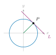
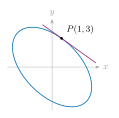
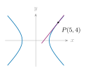
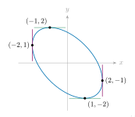
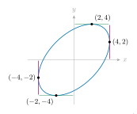

::: {.source-note}
[Lecture PDF · October 21, 2026](../downloads/october-21-inverse-implicit-class-notes.pdf)
:::

An *explicit* formula writes $y$ directly as a function of $x$: 

$$
y=f(x),\qquad y'=\frac{df}{dx}.
$$

 An *implicit* equation relates $x$ and $y$: 

$$
F(x,y)=0.
$$

 For example, $x^2+y^2=1$ gives the two branches $y=\pm\sqrt{1-x^2}$, while $x\cos y=2$ gives a different relation between $x$ and $y$.

**Question.** How do we compute $y'$ without first solving for $y$?

**Example 1.**

Find the slope of the tangent line to $x^2+y^2=1$ at $P=(1/\sqrt2,1/\sqrt2)$.

**Geometry.** The radius through $P$ lies on $y=x$, so its slope is $1$. The tangent is perpendicular to the radius, hence its slope is $-1$.

{fig-alt="Unit circle with radius to P=(1/sqrt(2),1/sqrt(2)) and a perpendicular tangent of slope minus one." width=290}

**Method 1: solve for $y$.**

On the first-quadrant branch, 

$$
y=\sqrt{1-x^2},\qquad y'=-\frac{x}{\sqrt{1-x^2}}.
$$

 At $x=1/\sqrt2$, 

$$
y'=-\frac{1/\sqrt2}{\sqrt{1-1/2}}=-1.
$$

**Method 2: implicit differentiation.**

Treat $y$ as a function of $x$ and differentiate both sides: 

$$
\begin{aligned}
\frac{d}{dx}(x^2+y^2)&=\frac{d}{dx}(1),\\
2x+\textcolor{#0072B2}{2y}\,\textcolor{#B44D00}{y'}&=0,\\
y'&=-\frac{x}{y}\qquad(y\ne0).
\end{aligned}
$$

 At $P$, $y'=-(1/\sqrt2)/(1/\sqrt2)=-1$ again.

**Implicit differentiation:** Differentiate the equation with respect to $x$, using the chain rule whenever $y$ appears, then solve for $y'$. The expression for $y'$ may involve both $x$ and $y$.

## Tangent slopes and vertical tangents

**Example 2.**

Find the slope of the tangent to $x^2+xy+y^2=13$ at $P=(1,3)$.

$$
\begin{aligned}
2x+\underbrace{y+xy'}_{\text{product rule}}+2yy'&=0,\\
(x+2y)y'&=-2x-y,\\
y'&=\frac{-2x-y}{x+2y}.
\end{aligned}
$$

 At $(1,3)$, the slope is 

$$
y'=\frac{-2-3}{1+6}=-\frac57.
$$

{fig-alt="The ellipse x squared plus xy plus y squared equals 13, with tangent at (1,3)." width=300}

**Example 3.**

Find the slope of the tangent to $x^2-y^2=9$ at $P=(5,4)$.

$$
2x-2yy'=0\quad\Longrightarrow\quad y'=\frac{x}{y}.
$$

 At $(5,4)$, the slope is $\dfrac54$.

{fig-alt="The hyperbola x squared minus y squared equals 9, with tangent at (5,4)." width=300}

**Example 4.**

For $x^2-y^2=9$, find all points where the tangent is vertical.

A horizontal tangent has $dy/dx=0$. For a vertical tangent, instead regard $x$ as a function of $y$ and look for $dx/dy=0$. 

$$
\begin{aligned}
\frac{d}{dy}(x^2-y^2)&=\frac{d}{dy}(9),\\
2x\frac{dx}{dy}-2y&=0,\\
\frac{dx}{dy}&=\frac{y}{x}.
\end{aligned}
$$

 The curve has $x\ne0$, so $dx/dy=0$ exactly when $y=0$. Substituting in the original equation gives 

$$
x^2=9\quad\Longrightarrow\quad x=\pm3.
$$

 Thus the vertical tangents occur at $(3,0)$ and $(-3,0)$; their equations are $x=3$ and $x=-3$.

## Example: the curve $x^2+xy+y^2=3$

**1. Find the tangent slope at $P=(1,1)$.** 

$$
\begin{aligned}
2x+y+xy'+2yy'&=0,\\
(x+2y)y'&=-2x-y,\\
y'&=\frac{-2x-y}{x+2y}.
\end{aligned}
$$

 At $(1,1)$, $y'=(-2-1)/(1+2)=-1$.

**2. Find all points where the tangent is horizontal.**

Set $y'=0$ in the differentiated equation. Then $2x+y=0$, so $y=-2x$. Substitute into the curve: 

$$
x^2+x(-2x)+(-2x)^2=3
\quad\Longrightarrow\quad3x^2=3
\quad\Longrightarrow\quad x=\pm1.
$$

 Find $y$ in each case using $y=-2x$: 

$$
\begin{aligned}
x=1&:\quad y=-2(1)=-2 &&\Longrightarrow\quad (1,-2),\\
x=-1&:\quad y=-2(-1)=2 &&\Longrightarrow\quad (-1,2).
\end{aligned}
$$

 The points are $(1,-2)$ and $(-1,2)$. At both, $x+2y=-3x\ne0$, so the tangent slope is indeed zero.

**3. Find all points where the tangent is vertical.**

Differentiate with respect to $y$: 

$$
2x\frac{dx}{dy}+y\frac{dx}{dy}+x+2y=0,
\qquad
\frac{dx}{dy}=-\frac{x+2y}{2x+y}.
$$

 For $dx/dy=0$, we need $x=-2y$. Substitution gives 

$$
(-2y)^2+(-2y)y+y^2=3
\quad\Longrightarrow\quad3y^2=3
\quad\Longrightarrow\quad y=\pm1.
$$

 Find $x$ in each case using $x=-2y$: 

$$
\begin{aligned}
y=1&:\quad x=-2(1)=-2 &&\Longrightarrow\quad (-2,1),\\
y=-1&:\quad x=-2(-1)=2 &&\Longrightarrow\quad (2,-1).
\end{aligned}
$$

 Thus the vertical tangents occur at $(-2,1)$ and $(2,-1)$. At both points, $2x+y=-3y\ne0$.

{fig-alt="The ellipse x squared plus xy plus y squared equals 3: horizontal tangents at (1,-2), (-1,2) and vertical tangents at (-2,1), (2,-1)." width=360}

## Practice: the curve $x^2-xy+y^2=12$

**1. Find the tangent slope at $P=(2,-2)$.** 

Show solution

$$
\begin{aligned}
2x-y-xy'+2yy'&=0,\\
(-x+2y)y'&=-2x+y,\\
y'&=\frac{-2x+y}{-x+2y}.
\end{aligned}
$$

 At $(2,-2)$, 

$$
y'=\frac{-4-2}{-2-4}=1.
$$

**2. Find all points where the tangent is horizontal.**

Show solution

Set $y'=0$. Then $2x-y=0$, so $y=2x$. Substituting, 

$$
x^2-x(2x)+(2x)^2=12
\quad\Longrightarrow\quad3x^2=12
\quad\Longrightarrow\quad x=\pm2.
$$

 Find $y$ in each case using $y=2x$: 

$$
\begin{aligned}
x=2&:\quad y=2(2)=4 &&\Longrightarrow\quad (2,4),\\
x=-2&:\quad y=2(-2)=-4 &&\Longrightarrow\quad (-2,-4).
\end{aligned}
$$

 Hence the horizontal tangents occur at $(2,4)$ and $(-2,-4)$. The denominator $-x+2y=3x$ is nonzero at both points.

**3. Find all points where the tangent is vertical.**

Show solution

Differentiate with respect to $y$: 

$$
2x\frac{dx}{dy}-y\frac{dx}{dy}-x+2y=0,
\qquad
\frac{dx}{dy}=\frac{x-2y}{2x-y}.
$$

 For $dx/dy=0$, we need $x=2y$. Substituting, 

$$
(2y)^2-(2y)y+y^2=12
\quad\Longrightarrow\quad3y^2=12
\quad\Longrightarrow\quad y=\pm2.
$$

 Find $x$ in each case using $x=2y$: 

$$
\begin{aligned}
y=2&:\quad x=2(2)=4 &&\Longrightarrow\quad (4,2),\\
y=-2&:\quad x=2(-2)=-4 &&\Longrightarrow\quad (-4,-2).
\end{aligned}
$$

 Thus the vertical tangents occur at $(4,2)$ and $(-4,-2)$. The denominator $2x-y=3y$ is nonzero at both points.

{fig-alt="The ellipse x squared minus xy plus y squared equals 12: horizontal tangents at (2,4), (-2,-4) and vertical tangents at (4,2), (-4,-2)." width=360}

