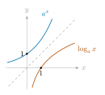
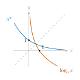
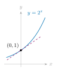
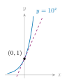
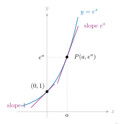

::: {.source-note}
[Lecture PDF · October 23, 2026](../downloads/october-23-exponential-logarithmic-class-notes.pdf)
:::

**Question.** How do we differentiate exponential and logarithmic functions? In particular, how do we find 

$$
\frac{d}{dx} e^x,\qquad \frac{d}{dx}\ln x,\qquad \frac{d}{dx} x^x?
$$

 Before answering, we review these functions and define the number $e$.

## Review

For $a>0$, let $f(x)=a^x$. The base $a=1$ gives the constant function $f(x)=1$. For a nonconstant exponential, the inverse is $f^{-1}(x)=\log_a x$. Thus $y=\log_a x$ means $a^y=x$, and 

$$
a^{\log_a x}=x\quad(x>0),\qquad \log_a(a^x)=x.
$$

 A nonconstant exponential has domain $\mathbb R$ and range $(0,\infty)$; its logarithmic inverse exchanges the domain and range.

:::: {.columns}
::: {.column width="50%"}
**$a>1$: exponential growth**

{fig-alt="The increasing exponential a to the x and its logarithmic inverse, reflected across y=x, with labels beside each curve." width=290}
:::
::: {.column width="50%"}
**$0<a<1$: exponential decay**

{fig-alt="The decreasing exponential a to the x, for a between zero and one, and its logarithmic inverse, reflected across y=x." width=290}
:::
::::

The dashed line is $y=x$; each pair of graphs reflects across it.

## Algebraic laws

For real $r,s$ and positive $M,N$, 

$$
a^{r+s}=a^ra^s,\qquad a^{r-s}=\frac{a^r}{a^s},\qquad (a^r)^s=a^{rs},
$$

 

$$
\log_a(M^r)=r\log_a M,\quad
\log_a(MN)=\log_a M+\log_a N,\quad
\log_a\frac MN=\log_a M-\log_a N.
$$

 Common bases are $2$, $10$, and $e\approx2.71828$. For base $e$, we write $\ln x=\log_e x$, the *natural logarithm*.

## What is $e$?

For $f(x)=a^x$, the slope at $x=0$, if it exists, is 

$$
f'(0)=\lim_{h\to0}\frac{a^{0+h}-a^0}{h}
=\lim_{h\to0}\frac{a^h-1}{h}.
$$

 We seek the base for which this slope is $1$.

**Lemma.**

For $a>0$, the function 

$$
F(a)=\lim_{h\to0}\frac{a^h-1}{h}
$$

 is well-defined, continuous, and strictly increasing.

> *Sketch.* Think of $F(a)$ as the tangent slope of $y=a^x$ at $(0,1)$. The exponential graphs are smooth there, so each has a tangent slope. As the base $a$ changes, the tangent turns continuously; increasing $a$ increases its slope. The two graphs below illustrate this for two bases greater than $1$: the larger base gives the steeper tangent.

:::: {.columns}
::: {.column width="50%"}
**Smaller base: $a=2$**

{fig-alt="The graph of 2 to the x, with its tangent at (0,1)." width=290}

Tangent slope: $F(2)$
:::
::: {.column width="50%"}
**Larger base: $a=10$**

{fig-alt="The graph of 10 to the x, with a steeper tangent at (0,1) than the graph of 2 to the x." width=290}

Tangent slope: $F(10)>F(2)$
:::
::::

**Lemma.**

There is a unique number $e\in(1,10)$ such that $F(e)=1$.

**Proof.**

Reading the slopes geometrically, $F(1)=0$, while the graph of $10^x$ has slope greater than $1$ at $(0,1)$, so $F(10)>1$. By continuity and the Intermediate Value Theorem, some $e\in(1,10)$ satisfies $F(e)=1$. Strict increase makes this $e$ unique.

**Definition.**

The unique positive real number $e$ for which 

$$
\lim_{h\to0}\frac{e^h-1}{h}=1
$$

 is called *Euler's number*.

**Note.** Another standard, equivalent definition is $\displaystyle e=\lim_{n\to\infty}\left(1+\frac1n\right)^n$.

## The natural exponential and logarithm

**Theorem.**

$$
\text{(i)}\quad \frac{d}{dx} e^x=e^x\quad(x\in\mathbb R),
\qquad
\text{(ii)}\quad \frac{d}{dx}\ln x=\frac1x\quad(x>0).
$$

**Proof.**

**(i)** By the definition of the derivative and the exponent laws, 

$$
\begin{aligned}
\frac{d}{dx} e^x
&=\lim_{h\to0}\frac{e^{x+h}-e^x}{h}\\
&=e^x\lim_{h\to0}\frac{e^h-1}{h}
=e^x\cdot1=e^x.
\end{aligned}
$$

 **(ii)** Let $f(x)=e^x$, so $f^{-1}(x)=\ln x$. By the inverse-function derivative theorem, 

$$
\frac{d}{dx}\ln x=(f^{-1})'(x)
=\frac1{f'(f^{-1}(x))}
=\frac1{e^{\ln x}}
=\frac1x.
$$

## Geometric meaning

For $f(x)=e^x$, the slope at $P(a,f(a))$ equals the height $f(a)$: 

$$
f'(a)=f(a)=e^a.
$$

 At $(0,1)$ the slope is $1$, and the tangent line is $y=1+x$.

{fig-alt="The graph of e to the x with tangent slope 1 at (0,1) and tangent slope e to the a at P=(a,e to the a); dotted guides mark a and the height e to the a." width=420}

## Relative growth

If $P(t)=P_0e^{kt}$, with $P_0>0$ and $k$ constant, then 

$$
P'(t)=P_0e^{kt}k=kP(t),\qquad
\frac{P'(t)}{P(t)}=k.
$$

 The relative growth rate is constant: $k>0$ gives growth, and $k<0$ gives decay.

## Worked examples

**Example 1.**

Differentiate $e^{x^2}$. 

$$
\frac{d}{dx} e^{x^2}
=\textcolor{#0072B2}{e^{x^2}}\,\textcolor{#B44D00}{2x}
=2xe^{x^2}.
$$

**Example 2.**

Differentiate $e^{\cos x}$. 

$$
\frac{d}{dx} e^{\cos x}
=\textcolor{#0072B2}{e^{\cos x}}\,\textcolor{#B44D00}{(-\sin x)}
=-e^{\cos x}\sin x.
$$

**Example 3.**

Differentiate $\ln(2x^3+7)$. 

$$
\frac{d}{dx}\ln(2x^3+7)
=\textcolor{#0072B2}{\frac1{2x^3+7}}\,\textcolor{#B44D00}{6x^2}
=\frac{6x^2}{2x^3+7}.
$$

## Practice

**Practice 1.**

Differentiate $e^{\sin x}$. 

Show solution

$$
\frac{d}{dx} e^{\sin x}
=\textcolor{#0072B2}{e^{\sin x}}\,\textcolor{#B44D00}{\cos x}
=e^{\sin x}\cos x.
$$

**Practice 2.**

Differentiate $\ln\sqrt{3x-2}$.

Show solution

**Logarithm laws.**

First simplify the logarithm: 

$$
\ln\sqrt{3x-2}=\frac12\ln(3x-2).
$$

 Then differentiate: 

$$
\frac{d}{dx}\ln\sqrt{3x-2}
=\frac12\cdot\frac{3}{3x-2}
=\frac{3}{2(3x-2)}.
$$

**Chain rule.**

The same derivative can be found directly: 

$$
\frac{d}{dx}\ln\sqrt{3x-2}
=\textcolor{#0072B2}{\frac1{\sqrt{3x-2}}}
\,\textcolor{#B44D00}{\frac1{2\sqrt{3x-2}}}
\,\textcolor{#9C2B79}{3}
=\frac{3}{2(3x-2)}.
$$

## Other bases

**Corollary.**

For $a>0$, 

$$
\text{(i)}\quad \frac{d}{dx} a^x=a^x\ln a.
$$

 For $a>0$, $a\ne1$, and $x>0$, 

$$
\text{(ii)}\quad \frac{d}{dx}\log_a x=\frac1{x\ln a}.
$$

**Proof.**

**(i)** Rewrite using $e$ and apply the chain rule: 

$$
\frac{d}{dx} a^x=\frac{d}{dx}(e^{\ln a})^x
=\frac{d}{dx} e^{x\ln a}
=e^{x\ln a}\ln a=a^x\ln a.
$$

 **(ii)** By change of base, $\log_a x=\ln x/\ln a$. Since $\ln a$ is constant, 

$$
\frac{d}{dx}\log_a x=\frac1{\ln a}\frac{d}{dx}\ln x=\frac1{x\ln a}.
$$

**Example 1.**

Differentiate $2^{3x}$. 

$$
\frac{d}{dx}2^{3x}=\textcolor{#0072B2}{2^{3x}\ln2}\cdot\textcolor{#B44D00}{3}=3(\ln2)2^{3x}.
$$

**Example 2.**

Differentiate $x^e e^x$. Here $e$ is a constant. 

$$
\frac{d}{dx}(x^e e^x)=ex^{e-1}e^x+x^e e^x
=e^x x^{e-1}(e+x).
$$

**Example 3.**

Differentiate $\log_2(6x^4+5)$. 

$$
\frac{d}{dx}\log_2(6x^4+5)
=\textcolor{#0072B2}{\frac1{(6x^4+5)\ln2}}\,\textcolor{#B44D00}{24x^3}
=\frac{24x^3}{(6x^4+5)\ln2}.
$$

## Practice

**Practice 1.**

Differentiate $x^\pi\pi^x$. 

Show solution

$$
\frac{d}{dx}(x^\pi\pi^x)
=\pi x^{\pi-1}\pi^x+x^\pi\pi^x\ln\pi
=x^{\pi-1}\pi^x(\pi+x\ln\pi).
$$

**Practice 2.**

Differentiate $\log_{10}(1+x^2)$. 

Show solution

$$
\frac{d}{dx}\log_{10}(1+x^2)=\frac{2x}{(1+x^2)\ln10}.
$$

## Logarithmic differentiation

**Question.** How do we differentiate $f(x)^{g(x)}$, when both the base and the exponent depend on $x$?

**Example.** Differentiate $x^x$.

**Method 1: rewrite using $e$.**

Since $x^x=e^{x\ln x}$, 

$$
\begin{aligned}
\frac{d}{dx} x^x
&=\frac{d}{dx} e^{x\ln x}\\
&=e^{x\ln x}\left(\ln x+x\cdot\frac1x\right)\\
&=x^x(\ln x+1).
\end{aligned}
$$

**Method 2: logarithmic differentiation.**

Let $y=x^x$. Take natural logarithms, then differentiate implicitly: 

$$
\begin{aligned}
\ln y&=x\ln x,\\
\frac{y'}y&=\ln x+1,\\
y'&=y(\ln x+1)=x^x(\ln x+1).
\end{aligned}
$$

 The derivative of $\ln y$ is $y'/y$ because $y$ is a function of $x$.

## The general calculation

Suppose $f$ and $g$ are differentiable and $f(x)>0$. Set $y=f(x)^{g(x)}$. Then $y>0$, so 

$$
\begin{aligned}
\ln y&=g(x)\ln f(x),\\
\frac{y'}y&=g'(x)\ln f(x)+g(x)\frac{f'(x)}{f(x)},\\
y'&=f(x)^{g(x)}
\left(g'(x)\ln f(x)+\frac{g(x)f'(x)}{f(x)}\right).
\end{aligned}
$$

 Taking logarithms turns a variable power into a product. Differentiate that product, solve for $y'$, and substitute the original expression for $y$.

## Examples of logarithmic differentiation

**Example 1.**

Let $y=x^{x^2}$. 

$$
\begin{aligned}
\ln y&=x^2\ln x,\\
\frac{y'}y&=2x\ln x+x^2\frac1x=2x\ln x+x,\\
y'&=x^{x^2}(2x\ln x+x).
\end{aligned}
$$

**Example 2.**

Let $y=(x^2-4)^{\ln x}$. 

$$
\begin{aligned}
\ln y&=(\ln x)\ln(x^2-4),\\
\frac{y'}y&=\frac{\ln(x^2-4)}x+\ln x\cdot\frac{2x}{x^2-4},\\
y'&=(x^2-4)^{\ln x}
\left(\frac{\ln(x^2-4)}x+\frac{2x\ln x}{x^2-4}\right).
\end{aligned}
$$

**Example 3.**

Let $y=x^{-1/2}(x^2+1)^{2/3}(2x-3)^4$. Taking logarithms gives 

$$
\ln y=-\frac12\ln x+\frac23\ln(x^2+1)+4\ln|2x-3|.
$$

 Differentiate term by term: 

$$
\frac{y'}y=-\frac1{2x}+\frac{4x}{3(x^2+1)}+\frac8{2x-3}.
$$

 Thus, 

$$
y'=x^{-1/2}(x^2+1)^{2/3}(2x-3)^4
\left(-\frac1{2x}+\frac{4x}{3(x^2+1)}+\frac8{2x-3}\right).
$$

## Practice

**Practice 1.**

Differentiate $y=x^{\sqrt{2x}}$. 

Show solution

$$
\begin{aligned}
\ln y&=\sqrt{2x}\ln x,\\
\frac{y'}y&=\frac{\ln x}{\sqrt{2x}}+\frac{\sqrt{2x}}x
=\frac{\ln x+2}{\sqrt{2x}},\\
y'&=\frac{x^{\sqrt{2x}}(\ln x+2)}{\sqrt{2x}}.
\end{aligned}
$$

**Practice 2.**

Differentiate $y=5^{\sin(2x)}$. 

Show solution

$$
\begin{aligned}
y'
&=\textcolor{#0072B2}{5^{\sin(2x)}\ln5}\cdot
\textcolor{#B44D00}{\cos(2x)}\cdot\textcolor{#9C2B79}{2}\\
&=2(\ln5)\,5^{\sin(2x)}\cos(2x).
\end{aligned}
$$

**Practice 3.**

Differentiate $y=(x^2-1)^{\sqrt{x}}$. 

Show solution

$$
\begin{aligned}
\ln y&=\sqrt{x}\ln(x^2-1),\\
\frac{y'}y&=\frac{\ln(x^2-1)}{2\sqrt{x}}+
\sqrt{x}\,\frac{2x}{x^2-1},\\
y'&=(x^2-1)^{\sqrt{x}}
\left(\frac{\ln(x^2-1)}{2\sqrt{x}}+
\frac{2x\sqrt{x}}{x^2-1}\right).
\end{aligned}
$$

## The power rule for real exponents

**Theorem.**

For any fixed real number $n$ and $x>0$, 

$$
\frac{d}{dx} x^n=nx^{n-1}.
$$

**Proof.**

Let $y=x^n$. Taking logarithms and differentiating gives 

$$
\ln y=n\ln x,\qquad
\frac{y'}y=\frac nx.
$$

 Therefore $y'=y(n/x)=nx^{n-1}$.

The restriction $x>0$ makes this proof work for every real exponent. The rule also holds at other inputs when the particular power function is differentiable there.
