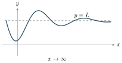
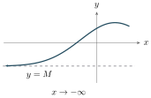
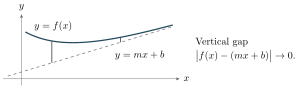

::: {.source-note}
Monday, November 9, 2026 · [Lecture PDF (textbook §4.6)](../downloads/november-9-end-behavior-and-curve-sketching.pdf) [Jump to practice](#practice)
:::

## 1. End behavior and limits at infinity {#end-behaviour}

### Horizontal asymptotes {#limits-at-infinity-and-horizontal-asymptotes}

:::: {.limit-pair}
::: {}
{fig-alt="At the right end, the graph oscillates about y=L with decreasing amplitude." width=310}

$\displaystyle\lim_{x\to+\infty} f(x)=L$
:::
::: {}
{fig-alt="At the left end, the graph approaches the horizontal line y=M." width=275}

$\displaystyle\lim_{x\to-\infty} f(x)=M$
:::
::::

::: {.statement .statement-definition #limit-at-infinity}
**Definition (limits at infinity).** We write $\lim_{x\to+\infty}f(x)=L$ when $f(x)$ approaches $L$ as $x$ increases without bound. Similarly, $\lim_{x\to-\infty}f(x)=L$ when $f(x)$ approaches $L$ as $x$ decreases without bound.

[In either case, the line $y=L$ is a **horizontal asymptote** of $f$.]{#horizontal-asymptote}
:::

Find the limits at both ends and identify any horizontal asymptotes.

**Example 1.** $\displaystyle f(x)=\frac{x^2-1}{x}=x-\frac1x$.

$$
\lim_{x\to-\infty} f(x)=-\infty,\qquad \lim_{x\to\infty}f(x)=+\infty.
$$

There is no horizontal asymptote.

**Example 2.** $\displaystyle f(x)=\frac{x+1}{x^3-1}$.

$$
\lim_{x\to\pm\infty}f(x)=\lim_{x\to\pm\infty}\frac{1/x^2+1/x^3}{1-1/x^3}=0.
$$

The horizontal asymptote is $y=0$.

### Rational functions {#end-behaviour-of-a-rational-function}

::: {.statement .statement-theorem #leading-terms}
**Theorem (end behavior of rational functions).** Let $p(x)=a_m x^m+\cdots+a_0$ and $q(x)=b_n x^n+\cdots+b_0$, with $a_m b_n\ne0$. At either end, $p/q$ has the same limit as the quotient of its leading terms,

$$
\lim_{x\to\pm\infty}\frac{p(x)}{q(x)}
=\lim_{x\to\pm\infty}\frac{a_m}{b_n}x^{m-n}.
$$

- If $m<n$, both limits are $0$.
- If $m=n$, both are $a_m/b_n$.
- If $m>n$, the sign of $(a_m/b_n)x^{m-n}$ determines $+\infty$ or $-\infty$ at each end.
:::

**Proof.** Factor out the leading power in each polynomial.

$$
\frac{p(x)}{q(x)}
=x^{m-n}\frac{a_m+a_{m-1}/x+\cdots+a_0/x^m}
{b_n+b_{n-1}/x+\cdots+b_0/x^n}.
$$

The fraction on the right tends to $a_m/b_n$ at both ends.

**Practice.** Find each limit as $x\to-\infty$ and as $x\to+\infty$.

1. $\displaystyle f(x)=\frac{1-x^3}{2x^3+x-1}$
2. $\displaystyle g(x)=\frac{-x^{2027}+x^{2026}-\cdots-x+1}{2026x^{2026}+\cdots+x+1}$

Show solutions

1. The leading terms give $-x^3/(2x^3)=-1/2$. Thus $\lim_{x\to+\infty}f(x)=\lim_{x\to-\infty}f(x)=-1/2$.
2. The leading terms give $-x/2026$. Hence
   $$
   \lim_{x\to+\infty}g(x)=-\infty,\qquad
   \lim_{x\to-\infty}g(x)=+\infty.
   $$

### Nonrational examples

**Example 1.** Find both end limits of $\displaystyle f(x)=\frac{\sqrt{4x^2+1}}{x}$.

Since $\sqrt{x^2}=|x|$, we have $f(x)=\dfrac{|x|}{x}\sqrt{4+1/x^2}$. The factor $|x|/x$ equals $-1$ on the left and $1$ on the right. Thus
$$
\lim_{x\to-\infty} f(x)=-2,\qquad \lim_{x\to+\infty} f(x)=2.
$$
The two ends have different horizontal asymptotes, $y=-2$ and $y=2$.

**Example 2.** Find both end limits of $\displaystyle g(x)=\frac{2x^2+4}{\sqrt{x^4+1}}$.

Here $\sqrt{x^4}=x^2$ at either end. Dividing by $x^2$ gives
$$
g(x)=\frac{2+4/x^2}{\sqrt{1+1/x^4}}\longrightarrow 2 \qquad (x\to\pm\infty).
$$
Both ends approach $y=2$.

### Slant asymptotes {#slant-asymptotes}

{fig-alt="The vertical gap between the curve and the slant line y=mx+b shrinks to zero as x increases." width=480}

::: {.statement .statement-definition #slant-asymptote}
**Definition (slant asymptote).** A nonhorizontal line $y=mx+b$ is a **slant asymptote** of $f$ if the difference
$$
f(x)-(mx+b)
$$
tends to zero as $x\to+\infty$ or as $x\to-\infty$. Its absolute value is the vertical distance shown above.
:::

**Example 1.** Find the slant asymptote of $\displaystyle f(x)=\frac{x^2-1}{x}$.

Since $f(x)=x-1/x$, the difference $f(x)-x=-1/x$ tends to zero at both ends. The slant asymptote is $y=x$.

**Example 2.** Find the slant asymptote of $\displaystyle g(x)=\frac{x^3}{x^2+1}$.

*Hint.* $x(x^2+1)=x^3+x$.

The difference $g(x)-x=-x/(x^2+1)$ tends to zero at both ends. The slant asymptote is $y=x$.

::: {.statement .statement-theorem #slant-by-division}
**Theorem (slant asymptote by division).** If $\deg P=\deg Q+1$, the line given by the quotient in polynomial division is a slant asymptote of $P/Q$ at both ends.
:::

**Proof.** Write $P=(mx+b)Q+R$ with $R=0$ or $\deg R<\deg Q$. Then

$$
\frac{P(x)}{Q(x)}-(mx+b)=\frac{R(x)}{Q(x)}\longrightarrow0
\qquad(x\to\pm\infty).
$$

**Example 3.** Divide $x^2$ by $x-1$.
$$
\begin{array}{r|rrr}
 & x+1 & & \\ \hline
x-1 & x^2 & +0x & +0 \\
    & x^2 & -x & \\ \hline
    &     & x & +0 \\
    &     & x & -1 \\ \hline
    &     &   & 1
\end{array}
$$
Thus $\dfrac{x^2}{x-1}=x+1+\dfrac{1}{x-1}$. The last term tends to zero at both ends, so the slant asymptote is $y=x+1$.

**Example 4.** Divide $x^3$ by $x^2+1$.
$$
\begin{array}{r|rrr}
 & x & & \\ \hline
x^2+1 & x^3 & +0x^2 & +0x \\
      & x^3 &       & +x \\ \hline
      &     &       & -x
\end{array}
$$
Thus $\dfrac{x^3}{x^2+1}=x-\dfrac{x}{x^2+1}$. The remainder term tends to zero at both ends, giving the slant asymptote $y=x$.

## 2. Curve sketching {#curve-sketching}

### Curve sketching steps

::: {.sketch-steps}
1. **Domain.** Identify the $x$-values where $f(x)$ is defined.
2. **Intercepts.** Solve $f(x)=0$ for the $x$-intercepts. The $y$-intercept is $(0,f(0))$ if $f(0)$ exists.
3. **Symmetry.** Even: $f(-x)=f(x)$. Odd: $f(-x)=-f(x)$. Periodic: $f(x+T)=f(x)$ for some $T>0$.
4. **Asymptotes.** Compute one-sided limits at domain breaks for vertical asymptotes. Check both ends for horizontal or slant asymptotes.
5. **Increase and decrease.** Draw a sign graph for $f'$. Identify intervals where $f'>0$ and where $f'<0$.
6. **Local extrema.** Classify the critical numbers using a derivative test.
7. **Concavity and inflection points.** Draw a sign graph for $f''$. Mark the points on the graph where concavity changes.
8. **Sketch.** Draw the asymptotes, plot the key points, and trace each branch using its direction and concavity.

:::

### Worked sketches

::::: {.sketch-item #example-1}
:::: {.sketch-pair}
::: {}
**Example 1.** Sketch the graph of

$\displaystyle f(x)=\frac{x}{x+1}$.
:::
::: {}
{fig-alt="Two increasing branches approach the dashed lines x=−1 and y=1. The branch to the right of x=−1 crosses the origin." width=420}
:::
::::

Worked sketch

**1. Domain.** $\mathbb R\setminus\{-1\}$.

**2. Intercepts.** Both axes meet the graph at $(0,0)$.

**3. Symmetry.** The graph is neither even nor odd.

**4. Asymptotes.** Write $f(x)=1-1/(x+1)$. Then
$$
\lim_{x\to-1^-}f(x)=+\infty,\qquad \lim_{x\to-1^+}f(x)=-\infty.
$$
The vertical asymptote is $x=-1$. At both ends $f(x)\to1$, so $y=1$ is a horizontal asymptote.

**5. Increase and decrease.** $f'(x)=1/(x+1)^2$ is positive on both $(-\infty,-1)$ and $(-1,\infty)$. Each branch is increasing.

**6. Local extrema.** The derivative is positive everywhere in the domain, so there are no critical numbers or local extrema.

**7. Concavity and inflection points.** $f''(x)=-2/(x+1)^3$. The graph is concave up on $(-\infty,-1)$ and concave down on $(-1,\infty)$. Since $-1$ is outside the domain, there is no inflection point.

{fig-alt="Across the break at −1, the first derivative is positive on both intervals. The second derivative changes from positive to negative." width=355}

**8. Sketch.** The left branch approaches $y=1$ from above. The right branch passes through the origin and approaches $y=1$ from below.

:::::

::::: {.sketch-item #example-8}
:::: {.sketch-pair}
::: {}
**Example 2.** Sketch the graph of

$\displaystyle f(x)=\frac{2x^2}{x^2-1}$.
:::
::: {}
{fig-alt="Even graph with two outer branches above y=2 and a central branch peaking at (0,0) between the vertical asymptotes x=−1 and x=1." width=450}
:::
::::

Worked sketch

**1. Domain.** $\mathbb R\setminus\{-1,1\}$.

**2. Intercepts.** Both axes meet the graph at $(0,0)$.

**3. Symmetry.** $f(-x)=f(x)$. The graph is symmetric about the $y$-axis.

**4. Asymptotes.** Factor $x^2-1=(x-1)(x+1)$. The numerator approaches $2$ at both excluded inputs, so the one-sided limits are

$$
\begin{aligned}
\lim_{x\to-1^-} f(x)&=+\infty, & \lim_{x\to-1^+} f(x)&=-\infty,\\
\lim_{x\to1^-} f(x)&=-\infty, & \lim_{x\to1^+} f(x)&=+\infty.
\end{aligned}
$$

Thus $x=-1$ and $x=1$ are vertical asymptotes. At both ends,

$$
\lim_{x\to\pm\infty}f(x)=\lim_{x\to\pm\infty}\left(2+\frac{2}{x^2-1}\right)=2.
$$

The graph approaches $y=2$ from above.

**5. Increase and decrease.** $\displaystyle f'(x)=\frac{-4x}{(x^2-1)^2}$.

{fig-alt="The first derivative has signs +, +, −, − across −1, 0, and 1. It vanishes at 0 and is undefined at −1 and 1." width=440}

- Increasing on each interval in $(-\infty,-1)\cup(-1,0)$.
- Decreasing on each interval in $(0,1)\cup(1,\infty)$.

**6. Local extrema.** At $x=0$, $f'$ changes from $+$ to $-$. The only local extremum is a maximum at $(0,0)$.

**7. Concavity and inflection points.** $\displaystyle f''(x)=\frac{4(3x^2+1)}{(x^2-1)^3}$.

{fig-alt="The second derivative is positive to the left of −1, negative between −1 and 1, and positive to the right of 1. Both breaks are outside the domain." width=440}

- Concave up on $(-\infty,-1)\cup(1,\infty)$.
- Concave down on $(-1,1)$.

Both changes of concavity occur at excluded inputs. There are no inflection points.

**8. Sketch.** Draw the middle branch through $(0,0)$ and the two outer branches above $y=2$.

:::::

### Practice {#practice}

::::: {.sketch-item}
:::: {.sketch-pair}
::: {}
[**Practice 1.**]{#example-9} Sketch $\displaystyle g(x)=\frac{x^3}{x^2+1}$. Mark the slant asymptote and each inflection point.
:::
::: {}
{fig-alt="An increasing odd curve approaches y=x at both ends. Its inflection points are (−√3, −3√3/4), (0,0), and (√3, 3√3/4)." width=465}
:::
::::

Show solution

**1. Domain.** $(-\infty,\infty)$.

**2. Intercepts.** Both intercepts are $(0,0)$.

**3. Symmetry.** $g(-x)=-g(x)$. The graph is symmetric about the origin.

**4. Asymptotes.** The denominator $x^2+1$ is positive everywhere. At both ends,

$$
\lim_{x\to\pm\infty}\bigl(g(x)-x\bigr)=\lim_{x\to\pm\infty}\frac{-x}{x^2+1}=0.
$$

The slant asymptote is $y=x$. The graph lies above it for $x<0$ and below it for $x>0$.

**5. Increase and decrease.** $\displaystyle g'(x)=\frac{x^2(x^2+3)}{(x^2+1)^2}$.

{fig-alt="The first derivative is zero at 0 and positive on both sides." width=440}

The function is strictly increasing on $(-\infty,\infty)$.

**6. Local extrema.** The tangent at the origin is horizontal. The derivative stays positive on either side, so there are no local extrema.

**7. Concavity and inflection points.** $\displaystyle g''(x)=\frac{2x(3-x^2)}{(x^2+1)^3}$.

{fig-alt="The second derivative has signs +, −, +, −, changing at minus square root of 3, 0, and square root of 3." width=440}

- Concave up on $(-\infty,-\sqrt3)\cup(0,\sqrt3)$.
- Concave down on $(-\sqrt3,0)\cup(\sqrt3,\infty)$.

**8. Sketch.** The inflection points are $(-\sqrt3,-3\sqrt3/4)$, $(0,0)$, and $(\sqrt3,3\sqrt3/4)$.

:::::

::::: {.sketch-item}
:::: {.sketch-pair}
::: {}
**Practice 2.** Sketch the graph of $\displaystyle f(x)=\frac4{x^2+3}$.
:::
::: {}
{fig-alt="An even curve above the x-axis peaks at (0,4/3) and changes concavity at (−1,1) and (1,1)." width=335}
:::
::::

Show solution

$$
\begin{aligned} f'(x)&=\frac{-8x}{(x^2+3)^2},\\[2pt] f''(x)&=\frac{24(x^2-1)}{(x^2+3)^3}.\end{aligned}
$$

The domain is $(-\infty,\infty)=\mathbb R$. The function is even. The only intercept is $(0,4/3)$. Since $\displaystyle\lim_{x\to\pm\infty}4/(x^2+3)=0$, both ends approach $y=0$ from above.

{fig-alt="The first derivative changes from + to − at 0. The second derivative changes from + to − at −1 and back to + at 1." width=285}

The function is increasing on $(-\infty,0)$ and decreasing on $(0,\infty)$, with a global maximum at $(0,4/3)$. It is concave up on $(-\infty,-1)$ and $(1,\infty)$ and concave down on $(-1,1)$. The inflection points are $(-1,1)$ and $(1,1)$.

:::::

::::: {.sketch-item}
:::: {.sketch-pair}
::: {}
**Practice 3.** Sketch the graph of $\displaystyle g(x)=\frac{x^2}{x-1}=x+1+\frac1{x-1}$.
:::
::: {}
{fig-alt="Two branches separated by x=1 approach the line y=x+1, with a local maximum at the origin and a local minimum at (2,4)." width=265}
:::
::::

Show solution

$$
\begin{aligned} g'(x)&=\frac{x(x-2)}{(x-1)^2},\\[2pt] g''(x)&=\frac2{(x-1)^3}.\end{aligned}
$$

The domain is $(-\infty,1)\cup(1,\infty)=\mathbb R\setminus\{1\}$. Both intercepts are $(0,0)$. The graph has half-turn symmetry about $(1,2)$.

At $x=1$, the left-hand limit is $-\infty$ and the right-hand limit is $+\infty$. For the slant asymptote,

$$
\lim_{x\to\pm\infty}\bigl[g(x)-(x+1)\bigr]=\lim_{x\to\pm\infty}\frac1{x-1}=0.
$$

The branch for $x<1$ lies below $y=x+1$, and the branch for $x>1$ lies above it.

{fig-alt="The first derivative has signs +, −, −, + across 0, 1, and 2. The second derivative is negative left of 1 and positive right of 1. Both derivatives are undefined at 1." width=285}

The function is increasing on $(-\infty,0)$ and $(2,\infty)$ and decreasing on $(0,1)$ and $(1,2)$. It has a local maximum at $(0,0)$ and a local minimum at $(2,4)$. It is concave down on $(-\infty,1)$ and concave up on $(1,\infty)$. There are no inflection points.

:::::
