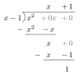

::: {.source-note}
Monday, November 9, 2026 · [Lecture PDF (textbook §4.6)](../downloads/november-9-end-behavior-and-curve-sketching.pdf) · [§4.5 Curve sketching](curve-sketching.qmd)
:::

[]{#end-behaviour}

## Horizontal asymptotes {#limits-at-infinity-and-horizontal-asymptotes}

:::: {.limit-pair}
::: {}
{fig-alt="At the right end, the graph oscillates about y=L with decreasing amplitude." width=310}

$\displaystyle\lim_{x\to+\infty} f(x)=L$
:::
::: {}
{fig-alt="At the left end, the graph approaches the horizontal line y=M." width=275}

$\displaystyle\lim_{x\to-\infty} f(x)=M$
:::
::::

::: {.statement .statement-definition #limit-at-infinity}
**Definition (limits at infinity).** We write $\lim_{x\to+\infty}f(x)=L$ when $f(x)$ approaches $L$ as $x$ increases without bound. Similarly, $\lim_{x\to-\infty}f(x)=L$ when $f(x)$ approaches $L$ as $x$ decreases without bound.

[In either case, the line $y=L$ is a **horizontal asymptote** of $f$.]{#horizontal-asymptote}
:::

Find the limits at both ends and identify any horizontal asymptotes.

**Example 1.** $\displaystyle f(x)=\frac{x^2-1}{x}=x-\frac1x$.

$$
\lim_{x\to-\infty} f(x)=-\infty,\qquad \lim_{x\to\infty}f(x)=+\infty.
$$

There is no horizontal asymptote.

**Example 2.** $\displaystyle f(x)=\frac{x+1}{x^3-1}$.

$$
\lim_{x\to\pm\infty}f(x)=\lim_{x\to\pm\infty}\frac{1/x^2+1/x^3}{1-1/x^3}=0.
$$

The horizontal asymptote is $y=0$.

## Rational functions {#end-behaviour-of-a-rational-function}

::: {.statement .statement-theorem #leading-terms}
**Theorem (end behavior of rational functions).** Let $p(x)=a_m x^m+\cdots+a_0$ and $q(x)=b_n x^n+\cdots+b_0$, with $a_m b_n\ne0$. At either end, $p/q$ has the same limit as the quotient of its leading terms,

$$
\lim_{x\to\pm\infty}\frac{p(x)}{q(x)}
=\lim_{x\to\pm\infty}\frac{a_m}{b_n}x^{m-n}.
$$

- If $m<n$, both limits are $0$.
- If $m=n$, both are $a_m/b_n$.
- If $m>n$, the sign of $(a_m/b_n)x^{m-n}$ determines $+\infty$ or $-\infty$ at each end.
:::

**Proof.** Factor out the leading power in each polynomial.

$$
\frac{p(x)}{q(x)}
=x^{m-n}\frac{a_m+a_{m-1}/x+\cdots+a_0/x^m}
{b_n+b_{n-1}/x+\cdots+b_0/x^n}.
$$

The fraction on the right tends to $a_m/b_n$ at both ends.

**Practice.** Find each limit as $x\to-\infty$ and as $x\to+\infty$.

1. $\displaystyle f(x)=\frac{1-x^3}{2x^3+x-1}$
2. $\displaystyle g(x)=\frac{-x^{2027}+x^{2026}-\cdots-x+1}{2026x^{2026}+\cdots+x+1}$

Show solutions

1. The leading terms give $-x^3/(2x^3)=-1/2$. Thus $\lim_{x\to+\infty}f(x)=\lim_{x\to-\infty}f(x)=-1/2$.
2. The leading terms give $-x/2026$. Hence
   $$
   \lim_{x\to+\infty}g(x)=-\infty,\qquad
   \lim_{x\to-\infty}g(x)=+\infty.
   $$

## Nonrational examples

**Example 1.** Find both end limits of $\displaystyle f(x)=\frac{\sqrt{4x^2+1}}{x}$.

Since $\sqrt{x^2}=|x|$, we have $f(x)=\dfrac{|x|}{x}\sqrt{4+1/x^2}$. The factor $|x|/x$ equals $-1$ on the left and $1$ on the right. Thus
$$
\lim_{x\to-\infty} f(x)=-2,\qquad \lim_{x\to+\infty} f(x)=2.
$$
The two ends have different horizontal asymptotes, $y=-2$ and $y=2$.

**Example 2.** Find both end limits of $\displaystyle g(x)=\frac{2x^2+4}{\sqrt{x^4+1}}$.

Here $\sqrt{x^4}=x^2$ at either end. Dividing by $x^2$ gives
$$
g(x)=\frac{2+4/x^2}{\sqrt{1+1/x^4}}\longrightarrow 2 \qquad (x\to\pm\infty).
$$
Both ends approach $y=2$.

## Slant asymptotes {#slant-asymptotes}

{fig-alt="The vertical gap between the curve and the slant line y=mx+b shrinks to zero as x increases." width=480}

::: {.statement .statement-definition #slant-asymptote}
**Definition (slant asymptote).** A nonhorizontal line $y=mx+b$ is a **slant asymptote** of $f$ if the difference
$$
f(x)-(mx+b)
$$
tends to zero as $x\to+\infty$ or as $x\to-\infty$. Its absolute value is the vertical distance shown above.
:::

**Example 1.** Find the slant asymptote of $\displaystyle f(x)=\frac{x^2-1}{x}$.

Since $f(x)=x-1/x$, the difference $f(x)-x=-1/x$ tends to zero at both ends. The slant asymptote is $y=x$.

**Example 2.** Find the slant asymptote of $\displaystyle g(x)=\frac{x^3}{x^2+1}$.

*Hint.* $x(x^2+1)=x^3+x$.

The difference $g(x)-x=-x/(x^2+1)$ tends to zero at both ends. The slant asymptote is $y=x$.

::: {.statement .statement-theorem #slant-by-division}
**Theorem (slant asymptote by division).** If $\deg P=\deg Q+1$, the line given by the quotient in polynomial division is a slant asymptote of $P/Q$ at both ends.
:::

**Proof.** Write $P=(mx+b)Q+R$ with $R=0$ or $\deg R<\deg Q$. Then

$$
\frac{P(x)}{Q(x)}-(mx+b)=\frac{R(x)}{Q(x)}\longrightarrow0
\qquad(x\to\pm\infty).
$$

**Example 3.** Divide $x^2$ by $x-1$.

{fig-alt="Long division of x squared by x minus one. The quotient is x plus one. Successive remainders are x and 1." width=196}

Thus $\dfrac{x^2}{x-1}=x+1+\dfrac{1}{x-1}$. The last term tends to zero at both ends, so the slant asymptote is $y=x+1$.

**Example 4.** Divide $x^3$ by $x^2+1$.

{fig-alt="Long division of x cubed by x squared plus one. The quotient is x. Subtracting x cubed plus x leaves minus x." width=250}

Thus $\dfrac{x^3}{x^2+1}=x-\dfrac{x}{x^2+1}$. The remainder term tends to zero at both ends, giving the slant asymptote $y=x$.

[Continue to §4.5 Curve sketching](curve-sketching.qmd){#curve-sketching}

