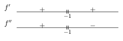
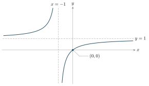
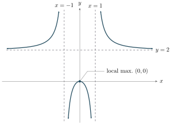
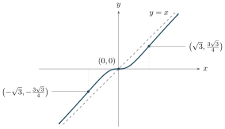
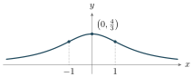
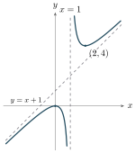

::: {.source-note}
Monday, November 9, 2026 · [Lecture PDF (textbook §4.6)](../downloads/november-9-end-behavior-and-curve-sketching.pdf)
:::

[]{#curve-sketching}

## Curve sketching steps {#curve-sketching-steps}

::: {.sketch-steps}
1. **Domain.** Give the domain in interval notation. Then give an equivalent description in set notation.
2. **Intercepts.** Solve $f(x)=0$ for the $x$-intercepts. The $y$-intercept is $(0,f(0))$ if $f(0)$ exists.
3. **Symmetry.** Check for even or odd symmetry and for periodicity.
   - *Even or odd.* On a domain symmetric about $0$, check whether $f(-x)=f(x)$ (even) or $f(-x)=-f(x)$ (odd) for every $x$ in the domain.
   - *Periodic.* Look for one fixed $T>0$ such that shifting the domain by $T$ gives the same domain and $f(x+T)=f(x)$ for every $x$ in it. The graph then repeats every $T$ units.
4. **Asymptotes.** At a suspected vertical asymptote $x=a$, check whether at least one one-sided limit is infinite. At each unbounded end of the domain, check for a horizontal or slant asymptote.
5. **Increase and decrease.** Mark domain breaks and points where $f'=0$ or $f'$ is undefined. On each open interval of the sign graph, $f'>0$ gives increase and $f'<0$ gives decrease.
6. **Local extrema.** Use the first or second derivative test at interior critical numbers when applicable. At an included endpoint, compare with nearby values in the domain.
7. **Concavity and inflection points.** Use a sign graph for $f''$ to determine concavity on each interval. Mark $(c,f(c))$ as an inflection point when $f$ is continuous at $c$ and concavity changes there.
8. **Sketch.** Draw the asymptotes, plot the key points, and trace each branch using its direction and concavity.

:::

## Worked sketches

::::: {.sketch-item #example-1}
**Example 1.** Sketch the graph of $\displaystyle f(x)=\frac{x}{x+1}$.

Worked sketch

**1. Domain.** $(-\infty,-1)\cup(-1,\infty)$, or equivalently, $\mathbb R\setminus\{-1\}$.

**2. Intercepts.** Both axes meet the graph at $(0,0)$.

**3. Symmetry.** The function is neither even nor odd.

**4. Asymptotes.** Write $f(x)=1-1/(x+1)$. Then
$$
\lim_{x\to-1^-}f(x)=+\infty,\qquad \lim_{x\to-1^+}f(x)=-\infty.
$$
The vertical asymptote is $x=-1$. At both ends $f(x)\to1$, so $y=1$ is a horizontal asymptote.

**5. Increase and decrease.** $f'(x)=1/(x+1)^2$ is positive on both $(-\infty,-1)$ and $(-1,\infty)$. Each branch is increasing.

**6. Local extrema.** The derivative is positive everywhere in the domain, so there are no critical numbers or local extrema.

**7. Concavity and inflection points.** $f''(x)=-2/(x+1)^3$. The graph is concave up on $(-\infty,-1)$ and concave down on $(-1,\infty)$. Since $-1$ is outside the domain, there is no inflection point.

{fig-alt="Across the break at −1, the first derivative is positive on both intervals. The second derivative changes from positive to negative." width=355}

**8. Sketch.** The left branch approaches $y=1$ from above. The right branch passes through the origin and approaches $y=1$ from below.

{fig-alt="Two increasing branches approach the dashed lines x=−1 and y=1. The branch to the right of x=−1 crosses the origin." width=420}

:::::

::::: {.sketch-item #example-8}
**Example 2.** Sketch the graph of $\displaystyle f(x)=\frac{2x^2}{x^2-1}$.

Worked sketch

**1. Domain.** $(-\infty,-1)\cup(-1,1)\cup(1,\infty)$, or equivalently, $\mathbb R\setminus\{-1,1\}$.

**2. Intercepts.** Both axes meet the graph at $(0,0)$.

**3. Symmetry.** $f(-x)=f(x)$. The graph is symmetric about the $y$-axis.

**4. Asymptotes.** Factor $x^2-1=(x-1)(x+1)$. The numerator approaches $2$ at both excluded inputs, so the one-sided limits are

$$
\begin{aligned}
\lim_{x\to-1^-} f(x)&=+\infty, & \lim_{x\to-1^+} f(x)&=-\infty,\\
\lim_{x\to1^-} f(x)&=-\infty, & \lim_{x\to1^+} f(x)&=+\infty.
\end{aligned}
$$

Thus $x=-1$ and $x=1$ are vertical asymptotes. At both ends,

$$
\lim_{x\to\pm\infty}f(x)=\lim_{x\to\pm\infty}\left(2+\frac{2}{x^2-1}\right)=2.
$$

The graph approaches $y=2$ from above.

**5. Increase and decrease.** $\displaystyle f'(x)=\frac{-4x}{(x^2-1)^2}$.

{fig-alt="The first derivative has signs +, +, −, − across −1, 0, and 1. It vanishes at 0 and is undefined at −1 and 1." width=440}

- $f'>0$ on $(-\infty,-1)\cup(-1,0)$, or equivalently, where $x<0$ and $x\ne-1$. The function increases on each interval.
- $f'<0$ on $(0,1)\cup(1,\infty)$, or equivalently, where $x>0$ and $x\ne1$. The function decreases on each interval.

**6. Local extrema.** At $x=0$, $f'$ changes from $+$ to $-$. The only local extremum is a maximum at $(0,0)$.

**7. Concavity and inflection points.** $\displaystyle f''(x)=\frac{4(3x^2+1)}{(x^2-1)^3}$.

{fig-alt="The second derivative is positive to the left of −1, negative between −1 and 1, and positive to the right of 1. Both breaks are outside the domain." width=440}

- Concave up on $(-\infty,-1)$ and $(1,\infty)$, or equivalently, where $|x|>1$.
- Concave down on $(-1,1)$, or equivalently, where $|x|<1$.

Both changes of concavity occur at excluded inputs. There are no inflection points.

**8. Sketch.** Draw the middle branch through $(0,0)$ and the two outer branches above $y=2$.

{fig-alt="Even graph with two outer branches above y=2 and a central branch peaking at (0,0) between the vertical asymptotes x=−1 and x=1." width=450}

:::::

## Practice {#practice}

::::: {.sketch-item}
[**Practice 1.**]{#example-9} Sketch $\displaystyle g(x)=\frac{x^3}{x^2+1}$. Mark the slant asymptote and each inflection point.

Show solution

**1. Domain.** $(-\infty,\infty)$, or equivalently, $\mathbb R$.

**2. Intercepts.** Both intercepts are $(0,0)$.

**3. Symmetry.** $g(-x)=-g(x)$. The graph is symmetric about the origin.

**4. Asymptotes.** The denominator $x^2+1$ is positive everywhere. At both ends,

$$
\lim_{x\to\pm\infty}\bigl(g(x)-x\bigr)=\lim_{x\to\pm\infty}\frac{-x}{x^2+1}=0.
$$

The slant asymptote is $y=x$. The graph lies above it for $x<0$ and below it for $x>0$.

**5. Increase and decrease.** $\displaystyle g'(x)=\frac{x^2(x^2+3)}{(x^2+1)^2}$.

{fig-alt="The first derivative is zero at 0 and positive on both sides." width=440}

$g'(x)>0$ on $(-\infty,0)\cup(0,\infty)$, and $g'(0)=0$. Thus $g$ increases on each of the two intervals. It is strictly increasing across $0$ as well. For $a<0<b$, we have $g(a)<g(0)=0<g(b)$.

**6. Local extrema.** The only critical number is $0$. The sign of $g'$ is positive on both sides, so the horizontal tangent at the origin gives no local extremum.

**7. Concavity and inflection points.** $\displaystyle g''(x)=\frac{2x(3-x^2)}{(x^2+1)^3}$.

{fig-alt="The second derivative has signs +, −, +, −, changing at minus square root of 3, 0, and square root of 3." width=440}

- Concave up on each of $(-\infty,-\sqrt3)$ and $(0,\sqrt3)$.
- Concave down on each of $(-\sqrt3,0)$ and $(\sqrt3,\infty)$.

The inflection points are $(-\sqrt3,-3\sqrt3/4)$, $(0,0)$, and $(\sqrt3,3\sqrt3/4)$.

**8. Sketch.** Draw $y=x$ and plot the three inflection points. Trace the increasing curve through the origin with a horizontal tangent there.

{fig-alt="An increasing odd curve approaches y=x at both ends. Its inflection points are (−√3, −3√3/4), (0,0), and (√3, 3√3/4)." width=465}

:::::

::::: {.sketch-item}
**Practice 2.** Sketch the graph of $\displaystyle f(x)=\frac4{x^2+3}$.

Show solution

**1. Domain.** $(-\infty,\infty)$, or equivalently, $\mathbb R$, since $x^2+3>0$ for every real $x$.

**2. Intercepts.** The $y$-intercept is $(0,4/3)$. The numerator is always $4$, so there is no $x$-intercept.

**3. Symmetry.** $f(-x)=f(x)$, so the graph is symmetric about the $y$-axis.

**4. Asymptotes.** The denominator never vanishes, so there is no vertical asymptote. At both ends,
$$
\lim_{x\to\pm\infty}\frac{4}{x^2+3}=0.
$$
The horizontal asymptote is $y=0$. Since $f(x)>0$, the graph approaches it from above.

**5. Increase and decrease.** $\displaystyle f'(x)=\frac{-8x}{(x^2+3)^2}$. Its sign is opposite to that of $x$. Thus $f$ increases on $(-\infty,0)$ and decreases on $(0,\infty)$.

{fig-alt="The first derivative changes from + to − at 0. The second derivative changes from + to − at −1 and back to + at 1." width=285}

**6. Local extrema.** At $x=0$, $f'$ changes from positive to negative. The point $(0,4/3)$ is a local maximum and also the global maximum. There is no local minimum.

**7. Concavity and inflection points.** $\displaystyle f''(x)=\frac{24(x^2-1)}{(x^2+3)^3}$. The graph is concave up on $(-\infty,-1)$ and $(1,\infty)$, and concave down on $(-1,1)$. Concavity changes at $x=\pm1$, where $f(\pm1)=1$. The inflection points are $(-1,1)$ and $(1,1)$.

**8. Sketch.** Plot the maximum and both inflection points. Draw the right branch decreasing toward $y=0$, changing concavity at $(1,1)$. Reflect it across the $y$-axis.

{fig-alt="An even curve above the x-axis peaks at (0,4/3) and changes concavity at (−1,1) and (1,1)." width=335}

:::::

::::: {.sketch-item}
**Practice 3.** Sketch the graph of $\displaystyle g(x)=\frac{x^2}{x-1}=x+1+\frac1{x-1}$.

Show solution

**1. Domain.** $(-\infty,1)\cup(1,\infty)$, or equivalently, $\mathbb R\setminus\{1\}$.

**2. Intercepts.** The numerator $x^2$ vanishes only at $x=0$. Since $g(0)=0$, both intercepts are $(0,0)$.

**3. Symmetry.** The domain excludes $1$ but includes $-1$, so $g$ is neither even nor odd.

**4. Asymptotes.** Write $g(x)=x+1+1/(x-1)$. The last term gives the one-sided limits
$$
\lim_{x\to1^-}g(x)=-\infty,\qquad
\lim_{x\to1^+}g(x)=+\infty.
$$
Thus $x=1$ is a vertical asymptote. At both ends, $g(x)-(x+1)=1/(x-1)\to0$, so $y=x+1$ is a slant asymptote.

**5. Increase and decrease.** $\displaystyle g'(x)=1-\frac1{(x-1)^2}=\frac{x(x-2)}{(x-1)^2}$. Split the domain at $0$, $1$, and $2$. The function increases on $(-\infty,0)$ and $(2,\infty)$, and decreases on $(0,1)$ and $(1,2)$.

{fig-alt="The first derivative has signs +, −, −, + across 0, 1, and 2. The second derivative is negative left of 1 and positive right of 1. Both derivatives are undefined at 1." width=285}

**6. Local extrema.** At $x=0$, $g'$ changes from positive to negative, giving a local maximum at $(0,0)$. At $x=2$, it changes from negative to positive, giving a local minimum at $(2,4)$.

**7. Concavity and inflection points.** $\displaystyle g''(x)=\frac{2}{(x-1)^3}$. The graph is concave down on $(-\infty,1)$ and concave up on $(1,\infty)$. The change occurs at the excluded input $x=1$, so there is no inflection point.

**8. Sketch.** Draw $x=1$ and $y=x+1$ first. The left branch lies below the slant line and peaks at $(0,0)$. The right branch lies above the line and turns upward at $(2,4)$.

{fig-alt="Two branches separated by x=1 approach the line y=x+1, with a local maximum at the origin and a local minimum at (2,4)." width=265}

:::::
