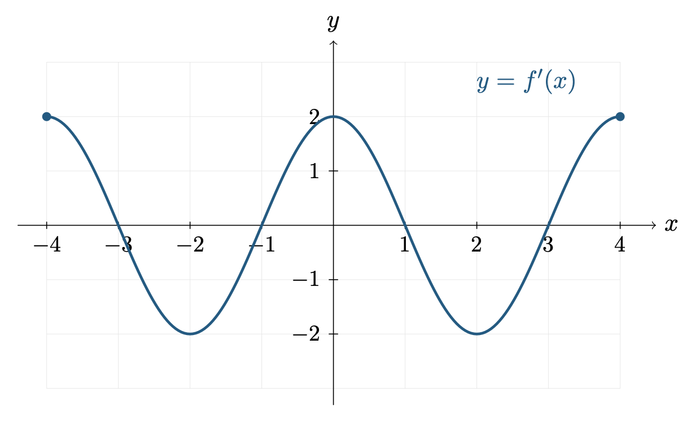
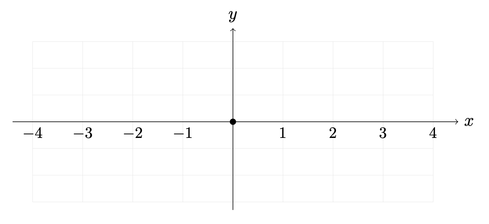
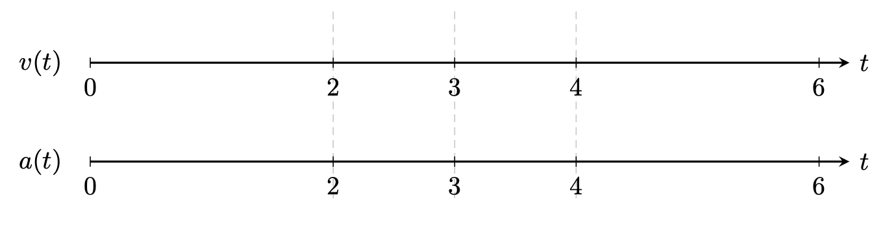

::: {.source-note}
Chapter 3 review · [Download the original 6-page worksheet](../downloads/exam-2-review-worksheet.pdf).
:::

## 1. Derivative definition

**(a)** Let $f(x)=x^2-3x$. Use the definition of the derivative
to find $f'(1)$, then find the tangent line at $x=1$.

**(b)** Let $r(x)=|x-2|$. Use the definition to determine whether
$r'(2)$ exists.

## 2. Limits

Identify each limit as a derivative and evaluate it.

**(a)** $\displaystyle\lim_{h\to0}\frac{e^{3h}-1}{h}$

**(b)** $\displaystyle\lim_{x\to2}\frac{x^3-8}{x-2}$

**(c)** $\displaystyle\lim_{h\to0}\frac{\sin(\pi/6+h)-\tfrac12}{h}$

## 3. Derivative graph

The smooth curve below is $y=f'(x)$. *This is not the graph of $f$.*

{fig-alt="The worksheet graph of y = f prime of x on minus 4 to 4, with a unit grid and labeled axes." width=700}

**(a)** Use only $-4<x<4$.

- $f$ is increasing on: ______
- $f$ is decreasing on: ______
- $f$ has horizontal tangents at: ______

**(b)** Does $f$ have a horizontal tangent at $x=2$? Explain.

**(c)** Write $+$, $-$, or $0$.

$$
\begin{aligned}
f''(-3):\ \underline{\hspace{.45in}}\qquad & f''(-1):\ \underline{\hspace{.45in}}\\[6pt]
f''(0):\ \underline{\hspace{.45in}}\qquad & f''(3):\ \underline{\hspace{.45in}}
\end{aligned}
$$

**(d)** Find the intervals where $f$ is concave up and where it is concave down.

**(e)** Sketch the shape of $f$ with $f(0)=0$.
Show the horizontal tangents and changes in concavity.

{fig-alt="Blank axes for sketching f, with x from minus 4 to 4 and the point (0,0) marked." width=700}

## 4. Differentiation

Compute the following derivatives.

**(a)** $\displaystyle\frac{d}{dx}\sqrt{1+\sin^2 x}$

**(b)** $\displaystyle\frac{d}{dx}\left(\frac{\cos x}{1+x^2}\right)$

**(c)** $\displaystyle\frac{d}{dx}\sin^{-1}(x^2)$, $-1<x<1$

**(d)** $\displaystyle\frac{d}{dx}\bigl[e^{x^2}\ln x\bigr]$, $x>0$

## 5. A derivative identity

Starting with $\cot x=\cos x/\sin x$, prove that
$\displaystyle\frac{d}{dx}\cot x=-\csc^2x$.

## 6. Motion

A cart has position

$$
s(t)=t^3-9t^2+24t\quad\text{meters},\qquad 0\le t\le6,
$$

where $t$ is measured in seconds.

**(a)** Find $v(t)$ and $a(t)$, including units. When is the cart at rest?

**(b)** Complete the sign graphs below. State when the cart moves
in the positive direction and when it moves in the negative direction.

{fig-alt="Two blank sign graphs labeled v(t) and a(t), with ticks at t = 0, 2, 3, 4, and 6." width=700}

**(c)** When does the cart reverse direction?

**(d)** Find the time intervals on which the cart's speed increases
and those on which it decreases. Justify your answer.

**(e)** Find the average velocity over $[0,6]$ and the instantaneous
velocity at $t=6$.

## 7. Inverse functions

Let $f$ be the inverse of $g(u)=u+\ln u$, defined for $u>0$.

**(a)** Find $f(1)$ and $f'(1)$ without finding a formula for $f$.

**(b)** Find the tangent line to $y=f(x)$ at $x=1$.

**(c)** Let $H(x)=\ln(f(x))$. Find $H'(e+1)$.

## 8. Implicit differentiation

Consider the curve $x^2+xy+y^2=3$.

**(a)** Find $dy/dx$.

**(b)** Find all points where the tangent is horizontal.

**(c)** Find all points where the tangent is vertical.

**(d)** Find all tangent lines to the curve that are parallel to $y=-x$.

## 9. Logarithmic differentiation

Use logarithmic differentiation to find $y'$.

**(a)** $\displaystyle y=(\sin x)^x,\qquad 0<x<\pi$

**(b)** $\displaystyle y=x^{\sqrt{x}},\qquad x>0$

## 10. Tangent lines

Let $\displaystyle q(x)=\frac{\ln x}{x}$, $x>0$.

**(a)** Find $q'(x)$.

**(b)** Find the point where the graph has a horizontal tangent.
Give both coordinates exactly.

**(c)** Find the tangent line at $x=1$.
