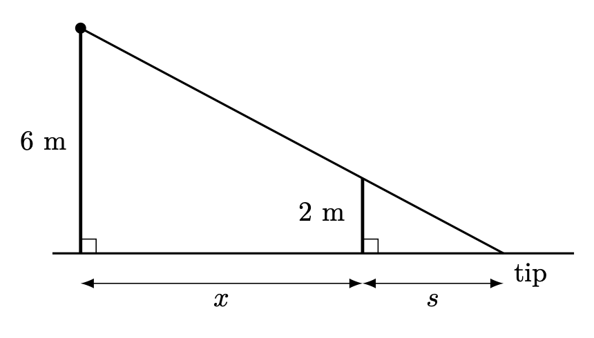
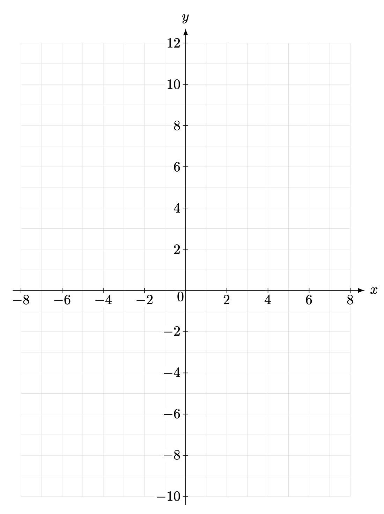

::: {.source-note}
Chapter 4 review · [Download the original 8-page worksheet](../downloads/exam-3-review-worksheet.pdf).
:::

## 1. What does the derivative tell us?

A differentiable function $f$ satisfies

$$
f'(x)=(x+2)(x-1)^2,\qquad x\in\mathbb R.
$$

**(a)** Find the critical numbers and draw a sign graph for $f'$.
State the intervals where $f'>0$ and where $f'<0$.

**(b)** Classify each critical number as a local maximum, local minimum,
or neither. Explain how the sign graph gives your conclusion.

**(c)** Can you determine the value of $f$ at a local extremum from
$f'$ alone? Explain.

## 2. Compare the tests

For each function, explain why $0$ is a critical number and classify it.
State whether the second derivative test gives a conclusion.

**(a)** $u(x)=|x|$

**(b)** $v(x)=x^3$

**(c)** $w(x)=-x^4$

## 3. Related rates: a moving shadow

A $2$ m tall person walks away from a $6$ m streetlight at $\tfrac32$ m/s.
Let $x$ be the person's distance from the pole and $s$ the length of the shadow.

{fig-alt="A 6 meter streetlight and a 2 meter person form similar right triangles. The distance from the pole to the person is x and the shadow length is s." width=560}

**(a)** Use similar triangles to relate $x$ and $s$.

**(b)** How fast is the shadow length changing?

**(c)** How fast is the tip of the shadow moving away from the pole?

## 4. Related rates: a sliding ladder

A $10$ ft ladder rests against a vertical wall. Its foot moves away from the
wall at $2$ ft/s. How fast is its top moving when its foot is $6$ ft from the wall?
Draw a diagram, define your variables, and include the sign and units of your rate.

## 5. Local and global extrema

Let

$$
g(x)=x^2e^{-x},\qquad -1\le x\le3.
$$

**(a)** Find the critical numbers. Use a sign graph for $g'$ to classify
each as a local maximum, local minimum, or neither.

**(b)** Check your classifications using the second derivative test.

**(c)** Find the global maximum and global minimum on $[-1,3]$.
Give their values and locations. Which local extrema from (a) are global?

## 6. The domain matters

Let $q(x)=(x-1)^2$. Find its global extrema on each domain, or explain why they
do not exist. State whether the Extreme Value Theorem applies.

**(a)** $[0,2]$

**(b)** $(0,2)$

## 7. Optimization: a printed flyer

A rectangular flyer must contain $96$ cm$^2$ of printed text.
The margins are $2$ cm on each side and $3$ cm at the top and bottom.

**(a)** Draw a labeled diagram. Express the total paper area in terms
of the printed width $x$. State the allowed values of $x$.

**(b)** Find the outer dimensions that use the least paper.
Use calculus to justify that the minimum is global.

**(c)** Find the minimum paper area.

## 8. Optimization: folding a box

Squares of side length $x$ are cut from the four corners of a $12$ cm square
sheet. The sides are folded up to form an open box.

**(a)** Express the volume in terms of $x$ and state its feasible interval.

**(b)** Find the dimensions of the box with greatest volume and its
volume. Justify that the maximum is global.

## 9. From a formula to a graph

Let

$$
f(x)=\frac{2x^2-3x+3}{x-1}.
$$

**(a)** Find the domain and all intercepts.

**(b)** Find all vertical asymptotes using one-sided limits.
Use polynomial long division to find the slant asymptote $y=mx+b$ and verify that
$f(x)-(mx+b)\to0$ as $x\to\pm\infty$.

**(c)** Find $f'$ and draw its sign graph. Determine the intervals of
increase and decrease. Classify every critical number and give the coordinates
of any local extrema.

**(d)** Draw a sign graph for $f''$. Determine the intervals of concavity
and the coordinates of all inflection points. You may use

$$
f''(x)=\frac{4}{(x-1)^3}.
$$

**(e)** Sketch $f$. Label its asymptotes, intercepts, local extrema, and
inflection points.

{fig-alt="Blank coordinate grid with x from minus 8 to 8 and y from minus 10 to 12 for sketching the rational function." width=520}

**(f)** Does $f$ have any global extrema? Does its graph cross the slant
asymptote? Justify your answers and give any crossing point.

## 10. A missing point

Let $\displaystyle H(x)=\frac{x^2-4}{x-2}$.
Find $\displaystyle\lim_{x\to2}H(x)$.
Is $2$ a critical number of $H$? Is $x=2$ a vertical asymptote? Justify.

## 11. Choosing a limit method

Evaluate each limit. Identify the form first, and show the steps that
justify your answer. Use l'Hospital's rule when appropriate.

**(a)** $\displaystyle\lim_{x\to-\infty}\frac{\sqrt{4x^2+1}}{x^2}$

**(b)** $\displaystyle\lim_{x\to2}\frac{\ln x-\ln2}{x-2}$

**(c)** $\displaystyle\lim_{x\to0}\frac{1-\cos(2x)}{x^2}$

**(d)** $\displaystyle\lim_{x\to\infty}\frac{2x+\sin x}{x}$

**(e)** $\displaystyle\lim_{x\to1^-}\frac{\ln x+2}{x-1}$

**(f)** $\displaystyle\lim_{x\to\infty}\frac{\ln x}{\sqrt{x}}$

**(g)** $\displaystyle\lim_{x\to-\infty}\bigl(\sqrt{x^2+4x}+x\bigr)$

## 12. Products and powers

Evaluate each limit. Show any change of form you use.

**(a)** $\displaystyle\lim_{x\to\infty}x\ln\left(1+\frac1x\right)$

**(b)** $\displaystyle\lim_{x\to0}(\cos x)^{1/x^2}$

**(c)** $\displaystyle\lim_{x\to\infty}x^{1/x}$
