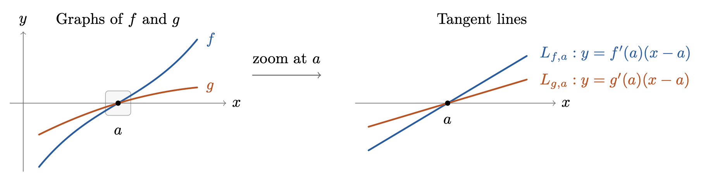

::: {.source-note}
Wednesday, November 18, 2026 · [Lecture PDF (textbook §4.8)](../downloads/lhopitals-rule.pdf)
:::

**Goal.** What is

$$
\lim_{x\to\infty}\frac{e^x}{x^2}?
$$

Both functions tend to infinity. We expect $e^x$ to grow faster than $x^2$, so their ratio should tend to infinity. We want a way to justify this and evaluate similar limits when the answer is less clear.

## l’Hospital’s rule {#lhospitals-rule}

::: {.statement .statement-definition #indeterminate-form}

**Definition 1.**

We say $\displaystyle\lim_{x\to a}\frac{f(x)}{g(x)}$ has indeterminate form
$0/0$ (respectively, $\infty/\infty$) if
$$
 \lim_{x\to a}f(x)=\lim_{x\to a}g(x)=0
 \qquad
 \left(\text{respectively, }|f(x)|,|g(x)|\to\infty\right).
$$

:::

$$
 \lim_{x\to0}\frac{\tan x}{x},
 \qquad
 \lim_{x\to\infty}\frac{e^x}{x^2}.
$$

::: {.statement .statement-theorem #lhospitals-theorem}

**Theorem 1 (l’Hospital’s rule).**

Let $f,g$ be differentiable near $a$, except possibly at $a$, with
$g'(x)\ne0$ for $x\ne a$ near $a$.
If $\displaystyle\lim_{x\to a}\frac{f(x)}{g(x)}$ has form $0/0$ or $\infty/\infty$, then
$$
 \lim_{x\to a}\frac{f(x)}{g(x)}
 =
 \lim_{x\to a}\frac{f'(x)}{g'(x)},
$$
provided the limit on the right exists, finite or infinite.
The same statement holds for one-sided limits and limits at $\pm\infty$.

:::

Sketch

**Case $0/0$.**
For simplicity, suppose $f,g$ are differentiable at $a$, with $g'(a)\ne0$.
Then
$$
 f(a)=\lim_{x\to a}f(x)=0,
 \qquad
 g(a)=\lim_{x\to a}g(x)=0.
$$

{fig-alt="The graphs of f and g meet at (a,0). Zoom at a shows their tangent lines, labelled L at f,a and L at g,a, with slopes f prime at a and g prime at a." width=740}

Near $a$,
$$
 \frac{f(x)}{g(x)}
 \approx
 \frac{f(a)+f'(a)(x-a)}{g(a)+g'(a)(x-a)}
 =
 \frac{f'(a)}{g'(a)}.
$$
Thus
$$
 \lim_{x\to a}\frac{f(x)}{g(x)}
 =
 \frac{f'(a)}{g'(a)}.
$$

**Case $\infty/\infty$.**
$$
\begin{aligned}
 \lim_{x\to a}\frac{f(x)}{g(x)}
 &=\lim_{x\to a}\frac{1/g(x)}{1/f(x)}\\
 &\overset{\mathrm{l'H}}{=}\lim_{x\to a}\frac{-g'(x)/g(x)^2}{-f'(x)/f(x)^2}\\
 &=\lim_{x\to a}\left[
 \left(\frac{f(x)}{g(x)}\right)^2\frac{g'(x)}{f'(x)}
 \right].
\end{aligned}
$$
$$
 \lim_{x\to a}\frac{f(x)}{g(x)}
 =
 \left(\lim_{x\to a}\frac{f(x)}{g(x)}\right)^2
 \lim_{x\to a}\frac{g'(x)}{f'(x)}
 \quad\Longrightarrow\quad
 \lim_{x\to a}\frac{f(x)}{g(x)}
 =
 \lim_{x\to a}\frac{f'(x)}{g'(x)}.
$$

## Check the form {#check-the-form}

**Example 1.** Evaluate $\displaystyle\lim_{x\to1}\frac{x^2}{x}$.

Show solution

The form is $1/1$, so direct substitution gives
$$
 \lim_{x\to1}\frac{x^2}{x}=1.
$$
Differentiating the numerator and denominator would give
$\displaystyle\lim_{x\to1}\frac{2x}{1}=2$, the wrong answer.
The rule requires form $0/0$ or $\infty/\infty$.

## Form $0/0$ {#zero-over-zero}

**Example 2.** Evaluate $\displaystyle\lim_{x\to2}\frac{x^2-4}{x-2}$.

Show solution

Form $0/0$.
$$
 \lim_{x\to2}\frac{x^2-4}{x-2}
 \overset{\mathrm{l'H}}{=} \lim_{x\to2}2x=4.
$$

**Example 3.** Evaluate $\displaystyle\lim_{x\to0}\frac{\sin x}{x}$.

Show solution

Form $0/0$.
$$
 \lim_{x\to0}\frac{\sin x}{x}
 \overset{\mathrm{l'H}}{=} \lim_{x\to0}\cos x=1.
$$

**Example 4.** Evaluate $\displaystyle\lim_{x\to0}\frac{\tan x-x}{x^3}$.

Show solution

Form $0/0$. Use $\sec^2x-1=\tan^2x$.
$$
 \lim_{x\to0}\frac{\tan x-x}{x^3}
 \overset{\mathrm{l'H}}{=} \lim_{x\to0}\frac{\sec^2x-1}{3x^2}
 =\frac13\lim_{x\to0}\left(\frac{\tan x}{x}\right)^2
 =\frac13.
$$
Here $\displaystyle\frac{\tan x}{x}=\frac{\sin x}{x}\frac1{\cos x}\to1$.

## Form $\infty/\infty$ {#infinity-over-infinity}

**Example 5.** Evaluate $\displaystyle\lim_{x\to\infty}\frac{e^x}{x^2}$.

Show solution

Form $\infty/\infty$ at both applications.
$$
 \lim_{x\to\infty}\frac{e^x}{x^2}
 \overset{\mathrm{l'H}}{=} \lim_{x\to\infty}\frac{e^x}{2x}
 \overset{\mathrm{l'H}}{=} \lim_{x\to\infty}\frac{e^x}{2}
 =+\infty.
$$

**Example 6.** Evaluate $\displaystyle\lim_{x\to\infty}\frac{\ln x}{\sqrt{x}}$.

Show solution

Form $\infty/\infty$.
$$
 \lim_{x\to\infty}\frac{\ln x}{\sqrt{x}}
 \overset{\mathrm{l'H}}{=} \lim_{x\to\infty}\frac{1/x}{1/(2\sqrt{x})}
 =\lim_{x\to\infty}\frac2{\sqrt{x}}=0.
$$

**Practice 1.** Evaluate $\displaystyle\lim_{x\to\pi^-}\frac{\sin x}{1-\cos x}$.

Show solution

The form is $0/2$. Direct substitution gives
$$
 \lim_{x\to\pi^-}\frac{\sin x}{1-\cos x}
 =\frac{0}{1-(-1)}=0.
$$

## Form $0\cdot\infty$ {#products}

**Example 7.** Evaluate $\displaystyle\lim_{x\to0^+}x\ln x$.

Show solution

Rewrite as a quotient of form $\infty/\infty$:
$$
 \lim_{x\to0^+}x\ln x
 =\lim_{x\to0^+}\frac{\ln x}{1/x}
 \overset{\mathrm{l'H}}{=} \lim_{x\to0^+}\frac{1/x}{-1/x^2}
 =\lim_{x\to0^+}(-x)=0.
$$

## Form $\infty-\infty$ {#differences}

**Example 8.** Evaluate $\displaystyle\lim_{x\to0^+}\left(\frac1x-\frac1{e^x-1}\right)$.

Show solution

Combine fractions. Both derivative steps have form $0/0$.
$$
\begin{aligned}
 \lim_{x\to0^+}\left(\frac1x-\frac1{e^x-1}\right)
 &=\lim_{x\to0^+}\frac{e^x-1-x}{x(e^x-1)}\\
 &\overset{\mathrm{l'H}}{=}\lim_{x\to0^+}\frac{e^x-1}{e^x-1+xe^x}\\
 &\overset{\mathrm{l'H}}{=}\lim_{x\to0^+}\frac{e^x}{2e^x+xe^x}
 =\frac12.
\end{aligned}
$$

**Practice 2.** Evaluate $\displaystyle\lim_{x\to\infty}\left(\sqrt{x^2+4x}-x\right)$.

Show solution

Form $\infty-\infty$. Multiply by the conjugate:
$$
\begin{aligned}
 \lim_{x\to\infty}\left(\sqrt{x^2+4x}-x\right)
 &=\lim_{x\to\infty}\frac{4x}{\sqrt{x^2+4x}+x}\\
 &=\lim_{x\to\infty}\frac4{\sqrt{1+4/x}+1}=2.
\end{aligned}
$$

## Indeterminate powers: $1^\infty$, $\infty^0$, $0^0$ {#indeterminate-powers}

For $f(x)>0$, set $y=f(x)^{g(x)}$. Then
$$
 \ln y=g(x)\ln f(x),\qquad y=e^{\ln y}.
$$

**Example 9 (Form $1^\infty$).** Evaluate $\displaystyle\lim_{x\to0^+}(1+x)^{1/x}$.

Show solution

Set $y=(1+x)^{1/x}$. Then
$$
 \lim_{x\to0^+}\ln y
 =\lim_{x\to0^+}\frac{\ln(1+x)}x
 \overset{\mathrm{l'H}}{=}\lim_{x\to0^+}\frac1{1+x}=1.
$$
Thus $\displaystyle\lim_{x\to0^+}(1+x)^{1/x}=e^1=e$.

**Example 10 (Form $\infty^0$).** Evaluate $\displaystyle\lim_{x\to\infty}x^{1/x}$.

Show solution

Set $y=x^{1/x}$. Then
$$
 \lim_{x\to\infty}\ln y
 =\lim_{x\to\infty}\frac{\ln x}{x}
 \overset{\mathrm{l'H}}{=}\lim_{x\to\infty}\frac1x=0.
$$
Thus $\displaystyle\lim_{x\to\infty}x^{1/x}=e^0=1$.

**Example 11 (Form $0^0$).** Evaluate $\displaystyle\lim_{x\to0^+}x^x$.

Show solution

Set $y=x^x$. Then
$$
 \lim_{x\to0^+}\ln y
 =\lim_{x\to0^+}x\ln x=0.
$$
Thus $\displaystyle\lim_{x\to0^+}x^x=e^0=1$.

**Practice 3.** Evaluate $\displaystyle\lim_{x\to0^+}(\cos x)^{1/x^2}$.

Show solution

Form $1^\infty$. Set $y=(\cos x)^{1/x^2}$.
$$
 \lim_{x\to0^+}\ln y
 =\lim_{x\to0^+}\frac{\ln(\cos x)}{x^2}
 \overset{\mathrm{l'H}}{=}-\frac12\lim_{x\to0^+}\frac{\tan x}{x}
 =-\frac12.
$$
Thus $\displaystyle\lim_{x\to0^+}(\cos x)^{1/x^2}=e^{-1/2}$.

**Practice 4.** Evaluate $\displaystyle\lim_{x\to0^+}(1+2x)^{1/x}$.

Show solution

Form $1^\infty$. Set $y=(1+2x)^{1/x}$.
$$
 \lim_{x\to0^+}\ln y
 =\lim_{x\to0^+}\frac{\ln(1+2x)}x
 \overset{\mathrm{l'H}}{=}\lim_{x\to0^+}\frac2{1+2x}=2.
$$
Thus $\displaystyle\lim_{x\to0^+}(1+2x)^{1/x}=e^2$.

