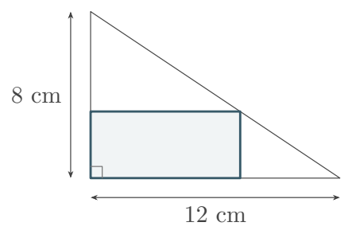
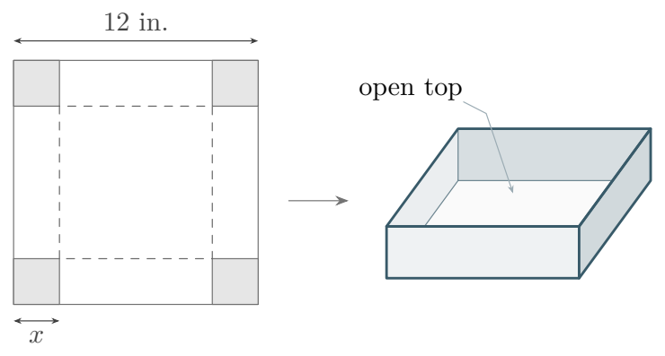
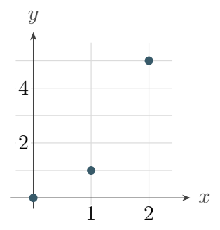
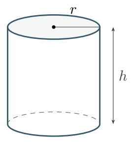
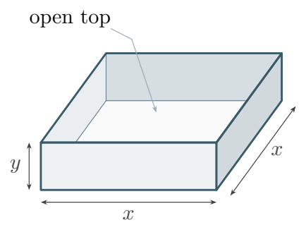
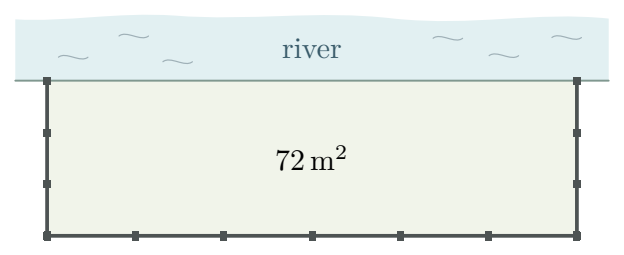
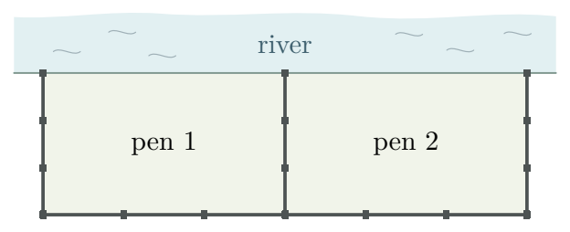
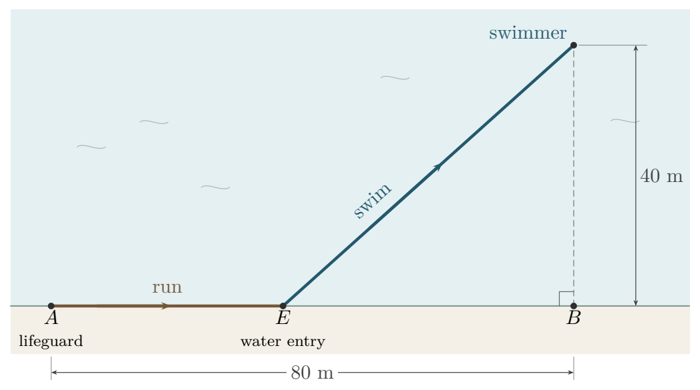
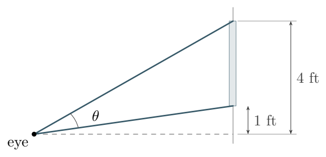
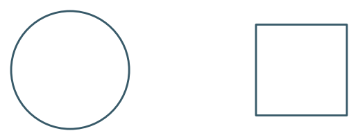

We’ve learned enough calculus to put it to work. In an optimization problem, the **objective function** is the quantity we want to maximize or minimize. The **constraints** tell us which choices are allowed.

$$
\left\{
\begin{aligned}
\text{maximize or minimize}\quad & F(x,y)\\
\text{subject to}\quad & (x,y)\in S
\end{aligned}
\right.
$$

Here $S$ is the set of all choices that satisfy the constraints. When a constraint lets us express one variable in terms of another, we can use derivatives to find the best value and check any included endpoints.

::: {.source-note}
Friday, November 13, 2026 · [Download the worksheet (PDF)](../downloads/optimization-worksheet.pdf) · Textbook §4.7
:::

## Part 1. Primer {#primer}

**Example 1.** Among all pairs $x,y\ge 0$ with $x+y=6$, which pair maximizes $xy$? Give the maximum value and justify why it is global.

Worked solution

$$
\left\{
\begin{aligned}
\text{maximize}\quad &P(x,y)=xy\\
\text{subject to}\quad &x+y=6,\quad x,y\ge 0
\end{aligned}
\right.
$$

Substitute $y=6-x$. Then $P(x)=x(6-x)$ on $[0,6]$, and $P'(x)=6-2x$ vanishes only at $x=3$. Compare $P(0)=P(6)=0$ with $P(3)=9$. The **global maximum is $9$**, attained at $(3,3)$.

**Example 2.** A rectangle has area $36\,\mathrm{cm}^2$. What is the smallest possible perimeter, and which dimensions attain it?

Worked solution

For sides $x,y>0$, minimize $P=2x+2y$ subject to $xy=36$. Since $y=36/x$,
$$
P(x)=2x+\frac{72}{x},\qquad P'(x)=2-\frac{72}{x^2}.
$$
The derivative is negative for $0<x<6$ and positive for $x>6$. The **minimum perimeter is $24$ cm**, attained by a $6$ cm square.

**Practice 1.** A rectangle sits inside a right triangle with legs of lengths $12$ cm and $8$ cm. Two sides lie along the legs, and the opposite corner lies on the hypotenuse. What is the greatest possible area of the rectangle?

{fig-alt="A rectangle shares the right angle of a triangle with base 12 cm and height 8 cm. Its opposite corner touches the hypotenuse." width=270}

Show solution

Let $x$ be the width along the $12$ cm leg. The hypotenuse joins $(0,8)$ to $(12,0)$, so the height is $y=8-\tfrac23x$. Thus
$$
A(x)=8x-\tfrac23x^2,\qquad A'(x)=8-\tfrac43x.
$$
The derivative changes from positive to negative at $x=6$. Then $y=4$, giving a **maximum area of $24\,\mathrm{cm}^2$**.

## Part 2. Optimization problems {#optimization-problems}

**Example 3.** Cut equal squares from the corners of a $12$-inch square of cardboard. Fold up the sides to make a box without a lid. What size cut gives the greatest volume? Give the box’s dimensions and volume.

{fig-alt="Four corner squares of side x are cut from a 12-inch sheet. The folded box has an open top." width=400}

Worked solution

A cut of side $x$ gives height $x$ and base side $12-2x$. For $0<x<6$,
$$
V(x)=x(12-2x)^2,\qquad V'(x)=12(x-2)(x-6).
$$
Volume increases up to $x=2$ and decreases thereafter. **Cut $2$-inch squares.** The $8\times8\times2$ inch box holds **$128\,\mathrm{in}^3$**.

**Example 4.** Fit the model $y=mx+2$ to the points $(0,0)$, $(1,1)$, and $(2,5)$. With the intercept fixed at $2$, the sum of squared errors is
$$
E(m)=4+(m+1)^2+(2m-3)^2.
$$
Which slope gives the least error, and what is that error?

{fig-alt="The three data points are plotted at (0,0), (1,1), and (2,5)." width=190}

Worked solution

Completing the square gives $E(m)=5(m-1)^2+9$. The squared term vanishes at **$m=1$**, so the fitted line is $y=x+2$ and the **minimum squared error is $9$**.

**Practice 2.** A closed cylindrical can must hold $54\pi\,\mathrm{cm}^3$. Which radius and height minimize its total surface area, including both ends? What is the minimum area?

{fig-alt="A closed cylinder with radius r and height h." width=155}

Show solution

The constraint $\pi r^2h=54\pi$ gives $h=54/r^2$. The two ends and the side have total area
$$
S(r)=2\pi r^2+2\pi rh=2\pi r^2+\frac{108\pi}{r},\qquad
S'(r)=\frac{4\pi(r^3-27)}{r^2}.
$$
For $r>0$, the derivative changes from negative to positive at $r=3$. Thus **$r=3$ cm, $h=6$ cm**, and the **minimum area is $54\pi\,\mathrm{cm}^2$**.

**Practice 3.** A tank with square base of side $x$, height $y$, and no lid uses $300\,\mathrm{cm}^2$ of sheet metal. Which dimensions give the greatest volume, and how much does the tank hold?

{fig-alt="An open tank has a square base with side x and four walls of height y." width=245}

Show solution

The base and four walls give $x^2+4xy=300$. Substitute $y=(300-x^2)/(4x)$ into $V=x^2y$. Then
$$
V(x)=\frac{300x-x^3}{4},\qquad V'(x)=\frac{300-3x^2}{4},\qquad 0<x<\sqrt{300}.
$$
Volume increases until $x=10$ and decreases thereafter. The tank is **$10\times10\times5$ cm** and holds **$500\,\mathrm{cm}^3$**.

**Example 5.** A farmer needs a rectangular pasture of area $72\,\mathrm{m}^2$ beside a straight river. Only three sides need fencing. Which dimensions use the least fence, and how much fence is needed?

{fig-alt="A rectangular pasture borders a river along one unfenced side. The other three sides are fenced." width=350}

Worked solution

Let $x$ be the depth and $y$ the length along the river. Since $xy=72$, the fence length is
$$
F(x)=2x+y=2x+\frac{72}{x},\qquad F'(x)=2-\frac{72}{x^2}.
$$
For $x>0$, the derivative changes from negative to positive at $x=6$. The pasture is **$6$ m deep and $12$ m along the river** and needs **$24$ m of fence**.

**Practice 4.** Divide the same $72\,\mathrm{m}^2$ pasture into two equal pens with a divider perpendicular to the river. Which dimensions should each pen have to minimize the total fencing, including the divider? How much fence is needed?

{fig-alt="Two equal pens share a fence perpendicular to the river. The river side is unfenced." width=350}

Show solution

Let $x$ be the depth and $y=72/x$ the **full** length along the river. The divider adds one depth, so
$$
F(x)=3x+\frac{72}{x},\qquad F'(x)=3-\frac{72}{x^2}.
$$
For $x>0$, the derivative changes from negative to positive at $x=2\sqrt6$. There $y=3x$, so **each pen** is **$2\sqrt6$ m deep and $3\sqrt6$ m along the river**. The total fence length is **$12\sqrt6$ m**.

## Part 3. Harder optimization problems {#harder-problems}

**Example 6.** A lifeguard starts at $A$. A swimmer is $40$ m directly offshore from $B$, which is $80$ m down the beach from $A$. The lifeguard runs at $100$ m/min and swims at $60$ m/min in still water. Where along $\overline{AB}$ should the lifeguard enter the water, and what is the minimum time?

{fig-alt="The lifeguard runs along the shore from A to an entry point E, then swims diagonally to a swimmer 40 m offshore from B. A and B are 80 m apart." width=510}

Worked solution

Let $x=EB$ be the shore distance remaining when the lifeguard enters the water. The run is $80-x$ meters and the swim is $\sqrt{x^2+40^2}$ meters, so the time in minutes is
$$
T(x)=\frac{80-x}{100}+\frac{\sqrt{x^2+40^2}}{60},\qquad 0\le x\le80.
$$
At a critical point,
$
T'(x)=-\frac1{100}+\frac{x}{60\sqrt{x^2+40^2}}=0
\quad\Longrightarrow\quad \frac{x}{\sqrt{x^2+40^2}}=\frac35.
$
The $3$–$4$–$5$ triangle gives $x=30$ and a $50$ m swim. The ratio on the left increases with $x$, so $T'$ changes from negative to positive. **Run $50$ m from $A$, then swim $50$ m.** The run takes $30$ seconds and the swim takes $50$, for a **minimum of $80$ seconds**.

**Practice 5.** A band sells $120$ tickets at $\$10$ each. For each $\$1$ price increase it expects to sell five fewer tickets. The venue charges $\$450$ plus $\$3$ per ticket sold. Which price maximizes revenue? Which price or prices maximize the band’s profit?

Show solution

Let $k\in\{0,1,\ldots,24\}$ count the dollar increases. The price is $10+k$ and sales are $120-5k$. Revenue and profit in dollars are
$$
\begin{aligned}
R(k)&=(10+k)(120-5k),\\
P(k)&=(7+k)(120-5k)-450.
\end{aligned}
$$
Both quadratics open downward. Revenue peaks at $k=7$, so a **$\$17$ ticket** gives **$\$1{,}445$ in revenue**. Profit has its vertex at $k=8.5$. The neighboring integers give $P(8)=P(9)=750$, so **$\$18$ and $\$19$ tie**, each yielding **$\$750$ profit**.

**Practice 6.** A painting hangs on a vertical wall. Its lower edge is $1$ ft above eye level and its upper edge is $4$ ft above. How far from the wall should you stand to maximize the angle between your sightlines to the edges?

{fig-alt="Two sightlines run from the eye to the painting’s edges, 1 ft and 4 ft above the horizontal through the eye." width=320}

Show solution

At distance $x>0$, subtract the lower sightline angle from the upper one. This gives
$$
\begin{aligned}
\theta(x)&=\arctan(4/x)-\arctan(1/x),\\
\theta'(x)&=\frac{1}{x^2+1}-\frac{4}{x^2+16}
=\frac{3(4-x^2)}{(x^2+1)(x^2+16)}.
\end{aligned}
$$
The angle increases until $x=2$ and decreases thereafter. **Stand $2$ ft from the wall.**

**Practice 7.** Cut a $24$ cm wire into two pieces of positive length. Form one into a circle and the other into a square. Which cut minimizes their combined area? Is there a cut that maximizes it?

{fig-alt="One piece of wire forms a circle, and the other forms a square." width=255}

Show solution

Let $c$ be the length used for the circle. Its radius is $c/(2\pi)$, and the square’s side is $(24-c)/4$. For $0<c<24$, the combined area is
$$
A(c)=\frac{c^2}{4\pi}+\frac{(24-c)^2}{16},\qquad
A'(c)=\frac{c}{2\pi}-\frac{24-c}{8}.
$$
Setting $A'(c)=0$ gives $4c=\pi(24-c)$. Since $A''>0$, the minimum uses **$24\pi/(\pi+4)$ cm for the circle** and **$96/(\pi+4)$ cm for the square**.

**There is no maximizing cut.** The largest limiting area, $144/\pi\,\mathrm{cm}^2$, is approached as $c\to24$, when the square’s piece shrinks to zero.

