::: {.source-note}
Monday, November 2, 2026 · [Examples and practice (PDF)](../downloads/related-rates-examples-practice.pdf) · [Answer sheet (PDF)](../downloads/related-rates-answer-sheet.pdf)
:::

## The three steps

Suppose $x$ and $y$ both change with time and $y=x^2$. Knowing $dx/dt$ tells us something about $dy/dt$. Differentiating the equation gives $dy/dt=2x\,dx/dt$. To find a numerical rate, we also need to know where $x$ is at the instant in question.

::: {.rr-method}
1. **Understand the situation.** Draw and label a picture. Define the variables as functions of time. Record the given measurements and rates, including signs and units. Let $t_0$ denote the instant in question and write the derivative you want to find.
2. **Relate rates.** Identify the variables in the given and desired rates. Find an equation connecting those variables, using the Pythagorean theorem, similar triangles, or an area or volume formula as needed. Differentiate both sides with respect to $t$. Solve for the desired rate when convenient.
3. **Plug in.** Once the derivative equation is ready, substitute the values at $t_0$. Report the sign, units, and direction when relevant.
:::

**A common mistake.** If $r(t_0)=2$, replacing $r$ by $2$ before differentiating treats the radius as constant. Keep the changing radius $r(t)$ in the volume formula. A *fixed* measurement, such as the length of a rigid ladder, may be used from the start.

## Part 1. Board problems

In these three problems, $x=x(t)$ and $y=y(t)$. The dot in each sketch marks the specified instant. No physical units are assigned.

### Example 1. Moving along a parabola {#parabola .rr-problem}

On $y=x^2$, the $x$-coordinate increases at 2 units per unit of time. How fast is $y$ changing when $x=3$?

::::: {.rr-setup}
::: {.rr-step}
[1. Understand the situation.]{.rr-step-label}

At $t_0$, $x=3$ and $dx/dt=2$. The point is $(3,9)$. Find $\left.\dfrac{dy}{dt}\right|_{t_0}$.
:::
::: {.rr-figure}
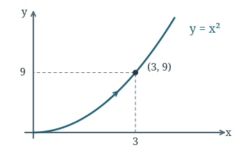{fig-alt="A point moves right and up along the parabola through (3, 9)."}
:::
:::::

[2. Relate rates.]{.rr-step-label}

Differentiate $y=x^2$ with respect to $t$.
$$
\frac{dy}{dt}=2x\frac{dx}{dt}.
$$

[3. Plug in.]{.rr-step-label}

At $x=3$, $\left.\dfrac{dy}{dt}\right|_{t_0}=2(3)(2)=12$. The $y$-coordinate is increasing by 12 units per unit of time.

### Example 2. Moving around a circle {#circle .rr-problem}

A point moves along $x^2+y^2=25$. At $(3,4)$, $dx/dt=2$. Find the rate of change of $y$.

::::: {.rr-setup}
::: {.rr-step}
[1. Understand the situation.]{.rr-step-label}

The radius is fixed at 5. At $t_0$, $(x,y)=(3,4)$ and the point is moving right. Find $\left.\dfrac{dy}{dt}\right|_{t_0}$.
:::
::: {.rr-figure}
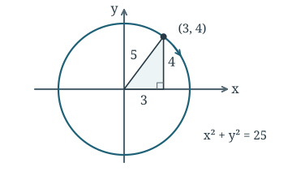{fig-alt="The radius to (3, 4) forms a 3–4–5 right triangle. The point moves to the right and down."}
:::
:::::

[2. Relate rates.]{.rr-step-label}

Implicit differentiation gives
$$
2x\frac{dx}{dt}+2y\frac{dy}{dt}=0,
\qquad \frac{dy}{dt}=-\frac{x}{y}\frac{dx}{dt}.
$$

[3. Plug in.]{.rr-step-label}

At $(3,4)$, $\left.\dfrac{dy}{dt}\right|_{t_0}=-\dfrac34(2)=-\dfrac32$. The point moves downward at $3/2$ units per unit of time.

### Practice 1. A constant product {#constant-product .rr-problem}

A point moves along $xy=12$. At $(3,4)$, $dy/dt=-2$. Find the rate of change of $x$.

::::: {.rr-setup}
::: {.rr-step}
[1. Understand the situation.]{.rr-step-label}

The coordinates change while their product stays fixed. At $t_0$, $x=3$, $y=4$, and $dy/dt=-2$. Find $\left.\dfrac{dx}{dt}\right|_{t_0}$.
:::
::: {.rr-figure}
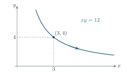{fig-alt="On the branch xy = 12 through (3, 4), decreasing y corresponds to increasing x."}
:::
:::::

[2. Relate rates.]{.rr-step-label}

Apply the product rule to $xy=12$.
$$
y\frac{dx}{dt}+x\frac{dy}{dt}=0,
\qquad \frac{dx}{dt}=-\frac{x}{y}\frac{dy}{dt}.
$$

[3. Plug in.]{.rr-step-label}

$\left.\dfrac{dx}{dt}\right|_{t_0}=-\dfrac34(-2)=\dfrac32$. The $x$-coordinate is increasing by $3/2$ units per unit of time.

## Part 2. Word problems

### Example 3. An inflating balloon {#balloon .rr-problem}

Air enters a spherical balloon at $12\pi\ \mathrm{cm^3/s}$. How fast is its radius increasing when the radius is 2 cm?

::::: {.rr-setup}
::: {.rr-step}
[1. Understand the situation.]{.rr-step-label}

Let $V(t)$ be the air volume and $r(t)$ the radius. At $t_0$, $r=2\ \mathrm{cm}$ and $dV/dt=12\pi\ \mathrm{cm^3/s}$. Find $\left.\dfrac{dr}{dt}\right|_{t_0}$ in cm/s.
:::
::: {.rr-figure}
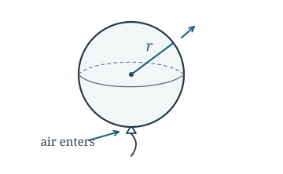{fig-alt="The radius r runs from the center of the spherical balloon to its surface. Air entering makes the radius grow."}
:::
:::::

[2. Relate rates.]{.rr-step-label}

Use the volume of a sphere.
$$
V=\frac43\pi r^3
\quad\Longrightarrow\quad
\frac{dV}{dt}=4\pi r^2\frac{dr}{dt}.
$$

[3. Plug in.]{.rr-step-label}

$\left.\dfrac{dr}{dt}\right|_{t_0}=\dfrac{12\pi}{4\pi(2)^2}=\dfrac34\ \mathrm{cm/s}$. The radius is increasing.

### Practice 2. A shrinking cube {#cube .rr-problem}

A cube’s volume decreases at $12\ \mathrm{m^3/s}$. Find the rate of change of its side length when the side is 2 m.

::::: {.rr-setup}
::: {.rr-step}
[1. Understand the situation.]{.rr-step-label}

Let $s(t)$ be the side length and $V(t)$ the volume. At $t_0$, $s=2\ \mathrm m$ and $dV/dt=-12\ \mathrm{m^3/s}$. Find $\left.\dfrac{ds}{dt}\right|_{t_0}$ in m/s.
:::
::: {.rr-figure}
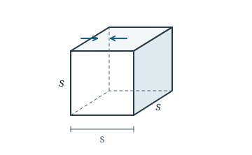{fig-alt="A cube with its edges labeled s. Arrows point inward as the cube shrinks."}
:::
:::::

[2. Relate rates.]{.rr-step-label}

All three edges have length $s$, so
$$
V=s^3 \quad\Longrightarrow\quad \frac{dV}{dt}=3s^2\frac{ds}{dt}.
$$

[3. Plug in.]{.rr-step-label}

$\left.\dfrac{ds}{dt}\right|_{t_0}=\dfrac{-12}{3(2)^2}=-1\ \mathrm{m/s}$. Each edge shortens by one meter per second.

### Example 4. A changing rectangle {#rectangle .rr-problem}

A rectangle’s length increases at 3 cm/s and its width decreases at 1 cm/s. How fast is its area changing when its length is 8 cm and its width is 5 cm?

::::: {.rr-setup}
::: {.rr-step}
[1. Understand the situation.]{.rr-step-label}

Let $L(t)$, $W(t)$, and $A(t)$ be the length, width, and area. At $t_0$, $L=8\ \mathrm{cm}$, $W=5\ \mathrm{cm}$, $dL/dt=3\ \mathrm{cm/s}$, and $dW/dt=-1\ \mathrm{cm/s}$. Find $\left.\dfrac{dA}{dt}\right|_{t_0}$.
:::
::: {.rr-figure}
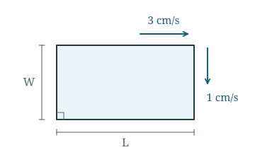{fig-alt="The base L lengthens at 3 cm/s while the width W shortens at 1 cm/s."}
:::
:::::

[2. Relate rates.]{.rr-step-label}

Both factors in $A=LW$ change. By the product rule,
$$
\frac{dA}{dt}=W\frac{dL}{dt}+L\frac{dW}{dt}.
$$

[3. Plug in.]{.rr-step-label}

$\left.\dfrac{dA}{dt}\right|_{t_0}=5(3)+8(-1)=7\ \mathrm{cm^2/s}$. The gain from the increasing length exceeds the loss from the decreasing width.

### Practice 3. A changing triangle {#triangle .rr-problem}

A triangle’s base decreases at 2 cm/min and its height increases at 3 cm/min. Find the rate of change of its area when the base is 8 cm and the height is 6 cm.

::::: {.rr-setup}
::: {.rr-step}
[1. Understand the situation.]{.rr-step-label}

Let $b(t)$ be the base, $h(t)$ its perpendicular height, and $A(t)$ the area. At $t_0$, $b=8\ \mathrm{cm}$, $h=6\ \mathrm{cm}$, $db/dt=-2\ \mathrm{cm/min}$, and $dh/dt=3\ \mathrm{cm/min}$. Find $\left.\dfrac{dA}{dt}\right|_{t_0}$.
:::
::: {.rr-figure}
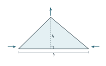{fig-alt="A dashed perpendicular height h meets the base b. The base shortens as the height increases."}
:::
:::::

[2. Relate rates.]{.rr-step-label}

Differentiate $A=\tfrac12 bh$ using the product rule.
$$
\frac{dA}{dt}=\frac12\left(h\frac{db}{dt}+b\frac{dh}{dt}\right).
$$

[3. Plug in.]{.rr-step-label}

$\left.\dfrac{dA}{dt}\right|_{t_0}=\tfrac12[6(-2)+8(3)]=6\ \mathrm{cm^2/min}$. The area is increasing.

### Similar triangles

::::: {.rr-setup}
::: {}
Two right triangles that share an acute angle are similar by angle–angle similarity. Match the vertical sides with one another and the horizontal sides with one another. If the larger triangle has height $H$ and base $B$, and the smaller has height $h$ and base $b$, then
$$
\frac{H}{B}=\frac{h}{b}.
$$
This proportion lets us eliminate a variable before differentiating.
:::
::: {.rr-figure}
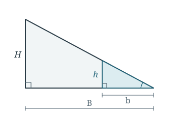{fig-alt="Two nested right triangles with matching heights H and h, bases B and b, and a shared angle at the tip."}
:::
:::::

## Part 3. More challenging models

### Example 5. A sliding ladder {#ladder .rr-problem}

A 10-ft ladder rests against a vertical wall. When its bottom is 6 ft from the wall, (a) if the bottom moves away at 2 ft/s, how fast and in what direction does the top move? (b) If the top instead moves downward at 3 ft/s at this position, how fast does the bottom move?

::::: {.rr-setup}
::: {.rr-step}
[1. Understand the situation.]{.rr-step-label}

Let $x(t)$ be the foot’s distance from the wall and $y(t)$ the top’s height. At $t_0$, $x=6\ \mathrm{ft}$. In (a), $dx/dt=2\ \mathrm{ft/s}$ and we seek $\left.dy/dt\right|_{t_0}$. In (b), $dy/dt=-3\ \mathrm{ft/s}$ and we seek $\left.dx/dt\right|_{t_0}$.
:::
::: {.rr-figure}
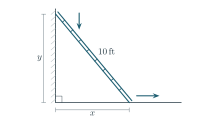{fig-alt="A fixed 10-foot ladder, vertical wall, and floor form a right triangle with legs y and x. The foot moves out as the top moves down."}
:::
:::::

[2. Relate rates.]{.rr-step-label}

The ladder is the fixed hypotenuse. The Pythagorean theorem gives
$$
x^2+y^2=10^2 \quad\Longrightarrow\quad
x\frac{dx}{dt}+y\frac{dy}{dt}=0.
$$

[3. Plug in.]{.rr-step-label}

At this instant $y=\sqrt{100-6^2}=8\ \mathrm{ft}$.

**(a)** $\left.\dfrac{dy}{dt}\right|_{t_0}=-\dfrac68(2)=-\dfrac32\ \mathrm{ft/s}$. The top slides **downward** at $3/2\ \mathrm{ft/s}$.

**(b)** $\left.\dfrac{dx}{dt}\right|_{t_0}=-\dfrac86(-3)=4\ \mathrm{ft/s}$. The foot moves **away from the wall**.

### Practice 4. A boat pulled toward a dock {#boat .rr-problem}

A rope connects a boat’s bow to a dock pulley 3 m above it. The bow stays at a fixed height, and the rope is pulled in at 1 m/s. How fast does the boat approach the dock when the horizontal distance from bow to pulley is 4 m?

::::: {.rr-setup}
::: {.rr-step}
[1. Understand the situation.]{.rr-step-label}

Let $x(t)$ be the horizontal distance and $L(t)$ the length of taut rope between the pulley and bow. At $t_0$, $x=4\ \mathrm m$ and $dL/dt=-1\ \mathrm{m/s}$. Find $\left.dx/dt\right|_{t_0}$, then report the approach speed.
:::
::: {.rr-figure}
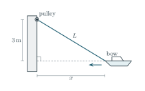{fig-alt="The taut rope L connects the bow and pulley. The horizontal distance x shortens while the vertical separation remains 3 m."}
:::
:::::

[2. Relate rates.]{.rr-step-label}

The vertical separation is fixed at 3 m.
$$
L^2=x^2+3^2 \quad\Longrightarrow\quad
L\frac{dL}{dt}=x\frac{dx}{dt}.
$$

[3. Plug in.]{.rr-step-label}

Here $L=\sqrt{4^2+3^2}=5\ \mathrm m$, so $\left.\dfrac{dx}{dt}\right|_{t_0}=\dfrac54(-1)=-\dfrac54\ \mathrm{m/s}$. The boat **approaches the dock at $5/4\ \mathrm{m/s}$**.

### Example 6. A conical tank {#cone .rr-problem}

An inverted conical tank is 6 m tall with top radius 2 m. Water enters at $\pi\ \mathrm{m^3/min}$. (a) Express its volume in terms of its depth. (b) How fast does the level rise at a depth of 3 m? (c) How would the rate change if water instead drained at $\pi\ \mathrm{m^3/min}$?

::::: {.rr-setup}
::: {.rr-step}
[1. Understand the situation.]{.rr-step-label}

Let $h(t)$ be water depth measured from the tip, $r(t)$ the water-surface radius, and $V(t)$ the water volume. Find $V(h)$ and $\left.dh/dt\right|_{t_0}$ when $h=3\ \mathrm m$. Filling gives $dV/dt=+\pi\ \mathrm{m^3/min}$ and draining gives $dV/dt=-\pi\ \mathrm{m^3/min}$.
:::
::: {.rr-figure}
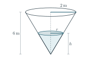{fig-alt="A shaded smaller cone of water has depth h and surface radius r inside a 6 m tank of top radius 2 m."}
:::
:::::

[2. Relate rates.]{.rr-step-label}

**(a)** In an axial cross section, the half-triangle for the water is similar to the half-triangle for the tank. Thus $r/h=2/6$, so $r=h/3$. Substitute this *relation* into the cone volume, then differentiate.
$$
V=\frac13\pi r^2h=\frac{\pi}{27}h^3,
\qquad \frac{dV}{dt}=\frac{\pi h^2}{9}\frac{dh}{dt}.
$$

[3. Plug in.]{.rr-step-label}

At $h=3\ \mathrm m$, the coefficient $\pi h^2/9$ is $\pi\ \mathrm{m^2}$.

**(b)** Filling gives $\left.\dfrac{dh}{dt}\right|_{t_0}=\dfrac{\pi}{\pi}=1\ \mathrm{m/min}$.

**(c)** Draining gives $\left.\dfrac{dh}{dt}\right|_{t_0}=\dfrac{-\pi}{\pi}=-1\ \mathrm{m/min}$. The level falls at the same speed.

### Practice 5. A person and a shadow {#shadow .rr-problem}

A 2-m-tall person walks away from a 6-m-tall streetlight at 2 m/s on level ground. How fast are (a) the shadow length and (b) the distance from the light to the shadow tip increasing?

::::: {.rr-setup}
::: {.rr-step}
[1. Understand the situation.]{.rr-step-label}

Let $x(t)$ be the distance from the light to the person and $s(t)$ the shadow length. The tip is $x+s$ meters from the light. Given $dx/dt=2\ \mathrm{m/s}$, find $ds/dt$ and $d(x+s)/dt$.
:::
::: {.rr-figure}
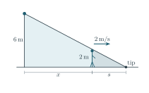{fig-alt="The lamp and person are the vertical sides of two similar triangles. From the lamp to the person is x, and from the person to the tip is s."}
:::
:::::

[2. Relate rates.]{.rr-step-label}

The light ray through the person’s head ends at the shadow tip. Comparing height to base in the two triangles gives
$$
\frac{6}{x+s}=\frac{2}{s}
\quad\Longrightarrow\quad 6s=2x+2s
\quad\Longrightarrow\quad s=\frac{x}{2}.
$$
Differentiate to obtain $\dfrac{ds}{dt}=\tfrac12\dfrac{dx}{dt}$. For the tip, $\dfrac{d(x+s)}{dt}=\dfrac{dx}{dt}+\dfrac{ds}{dt}$.

[3. Plug in.]{.rr-step-label}

**(a)** The shadow length grows at $\dfrac{ds}{dt}=\tfrac12(2)=1\ \mathrm{m/s}$.

**(b)** The tip moves away from the light at $\dfrac{d(x+s)}{dt}=2+1=3\ \mathrm{m/s}$. These rates hold at every instant while the walking speed is 2 m/s.
