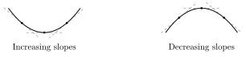
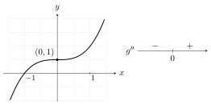
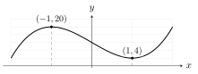
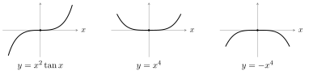

::: {.source-note}
Friday, November 6, 2026 · Transcribed by Cleo McBride · [Lecture PDF (textbook §4.5)](../downloads/november-6-local-extrema-and-concavity.pdf)
:::

**Goal.** Given a critical number $c$, determine whether $f(c)$ is a local maximum, a local minimum, or neither.

## The first derivative test

::: {.statement .statement-theorem #first-derivative-test}
**Theorem (first derivative test).** Let $c$ be an interior critical number of $f$, with $f$ continuous at $c$. Suppose that on each side of $c$, sufficiently close to $c$, $f'$ exists and is either strictly positive throughout or strictly negative throughout. Then
$$
f\text{ has a local extremum at }c
\quad\Longleftrightarrow\quad
f'\text{ changes sign at }c.
$$
In particular, reading from left to right:

- Positive to negative: $f$ has a strict local maximum at $c$.
- Negative to positive: $f$ has a strict local minimum at $c$.
- Positive on both sides, or negative on both sides: $f$ has no local extremum at $c$.
:::

**Note.** We say that $f'$ *changes sign at $c$* if, for some $\delta>0$, $f'$ is positive throughout $(c-\delta,c)$ and negative throughout $(c,c+\delta)$, or vice versa.

{fig-alt="At c = 0 the derivative −2x changes from positive to negative. Beside its sign graph, the parabola y = 1 − x² rises to (0,1) and then falls." width=515}

**Proof (postponed).** We will use the following consequence of the Mean Value Theorem. If $f'>0$ on an interval, then $f$ is increasing there. Similarly, if $f'<0$, then $f$ is decreasing.

**Example 1.** Classify the interior critical numbers of $f(x)=4x^3-12x+12$ on $[-2,3]$.

Solution

The derivative $f'(x)=12(x-1)(x+1)$ vanishes at $-1$ and $1$. Both factors are negative on $(-2,-1)$, their signs are opposite on $(-1,1)$, and both are positive on $(1,3)$. Thus $f'$ changes from positive to negative at $-1$, giving a local maximum of $f(-1)=20$. At $1$, the change from negative to positive gives a local minimum of $f(1)=4$.

{fig-alt="The derivative has signs positive, negative, positive on the three intervals cut by minus one and one." width=385}

**Example 2.** Classify $x=0$ for $p(x)=\cos x$.

Solution

The derivative $p'(x)=-\sin x$ is positive on $(-\pi/2,0)$ and negative on $(0,\pi/2)$. Hence $p(0)=1$ is a local maximum.

## Concavity and inflection points

::: {.statement .statement-definition #concavity}
**Definition (concavity).** On an interval where $f$ is differentiable, its graph is *concave up* if $f'$ is increasing, and *concave down* if $f'$ is decreasing.
:::

{fig-alt="Three tangent lines on each curve show slopes increasing from left to right on the first curve and decreasing on the second." width=475}

::: {.statement .statement-theorem #concavity-test}
**Theorem (concavity test).** If $f''>0$ throughout an interval, the graph of $f$ is concave up there. If $f''<0$ throughout an interval, it is concave down.
:::

::: {.statement .statement-definition #inflection-point}
**Definition (inflection point).** If $f$ is continuous at $c$ and its graph changes concavity there, then $(c,f(c))$ is an *inflection point*.
:::

**Example 3.** Where does the graph of $g(x)=x^3+1$ change concavity?

Solution

Differentiate twice: $g'(x)=3x^2$ and $g''(x)=6x$. The second derivative is negative on $(-\infty,0)$ and positive on $(0,\infty)$. The graph changes from concave down to concave up at $(0,1)$. Here $g'(0)=0$, but $g$ increases on both sides of zero.

{fig-alt="The increasing cubic flattens at (0,1). Its second derivative changes from negative to positive at zero." width=445}

## The second derivative test

::: {.statement .statement-theorem #second-derivative-test}
**Theorem (second derivative test).** Suppose $f'(c)=0$ and $f''$ is continuous on an open interval containing $c$.

- If $f''(c)>0$, then $f(c)$ is a strict local minimum.
- If $f''(c)<0$, then $f(c)$ is a strict local maximum.
- If $f''(c)=0$, the test is inconclusive.
:::

Proof

If $f''(c)>0$, continuity keeps $f''$ positive near $c$. Thus $f'$ increases through $f'(c)=0$, from negative values to positive values. The first derivative test gives a local minimum. When $f''(c)<0$, $f'$ decreases through zero, giving a local maximum.

**Example 4.** Return to the cubic $f(x)=4x^3-12x+12$ from Example 1. Classify its two critical numbers using the second derivative test.

Solution

The derivative factors as $f'(x)=12(x-1)(x+1)$, so the critical numbers are $-1$ and $1$. Since $f''(x)=24x$,

- $f''(-1)=-24<0$ gives a local maximum at $(-1,20)$.
- $f''(1)=24>0$ gives a local minimum at $(1,4)$.

{fig-alt="The cubic rises to the local maximum (−1,20), falls to the local minimum (1,4), then rises again." width=370}

**Example 5.** Use the second derivative test to classify $x=0$ for $f(x)=x\tan x$.

Solution

The product rule gives
$$
f'(x)=\tan x+x\sec^2 x,\qquad f''(x)=2\sec^2 x(1+x\tan x).
$$
Since $f'(0)=0$ and $f''(0)=2>0$, $f$ has a strict local minimum at $(0,0)$.

**Practice.** Now let $h(x)=x^2\tan x$. Compute $h'(0)$ and $h''(0)$. What does the second derivative test tell you? Is there a local extremum at $0$? Justify your answer.

Solution

Differentiating twice gives
$$
\begin{aligned}
h'(x)&=2x\tan x+x^2\sec^2 x,\\
h''(x)&=2\tan x+4x\sec^2 x+2x^2\sec^2 x\tan x.
\end{aligned}
$$
Both derivatives vanish at zero, so the test is inconclusive. For $0<|x|<\pi/2$, the factor $x^2$ is positive and $\tan x$ has the same sign as $x$. Thus $h(x)<h(0)$ just to the left of zero and $h(x)>h(0)$ just to the right. There is no local extremum at $0$.

**Comparison.** All three functions below satisfy $f'(0)=f''(0)=0$. At $0$, $x^2\tan x$ has neither extremum, $x^4$ has a local minimum, and $-x^4$ has a local maximum.

{fig-alt="Near zero, x squared times tangent x passes through the origin, x to the fourth has a minimum, and negative x to the fourth has a maximum." width=590}

