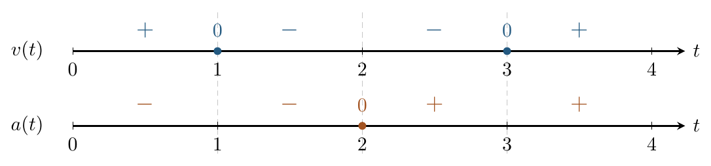

::: {.source-note}
**An optional guide to the big ideas.** Follow the arrows to see how concepts from the course fit together. Use the links below each map to return to the notes. On a narrow screen, scroll sideways to see each map.
:::

```{=html}
<style>
.idea-map { margin: 1.2rem 0 .7rem; }
.idea-map svg { width: 100%; height: auto; display: block; }
.idea-map rect { fill: var(--reading-bg, #fff); stroke: var(--reading-border, #999); stroke-width: 1.5; }
.idea-map path { fill: none; stroke: var(--reading-muted, #555); stroke-width: 1.6; }
.idea-map .node-title { fill: var(--reading-text, #222); font: 600 17px system-ui, sans-serif; text-anchor: middle; }
.idea-map .node-sub { fill: var(--reading-muted, #555); font: 13px system-ui, sans-serif; text-anchor: middle; }
.idea-map .edge-label { fill: var(--reading-muted, #555); font: 13px system-ui, sans-serif; text-anchor: middle; paint-order: stroke; stroke: var(--reading-bg, #fff); stroke-width: 5px; stroke-linejoin: round; }
.map-relationships { padding-left: 1.3rem; }
.map-relationships li { margin: .35rem 0; }
.map-guide-details { margin: 2rem 0; border-top: 1px solid var(--reading-border, #aaa); padding-top: 1rem; }
.map-guide-details summary { cursor: pointer; font-weight: 600; }
.map-guide-details .concept-guides { margin-top: 1rem; }
@media (max-width: 650px) { .idea-map { overflow-x: auto; } .idea-map svg { min-width: 650px; } }
@media print { .idea-map { break-inside: avoid; } .map-guide-details { display: none; } }
</style>
```

## 1. Limits, continuity, and the derivative

How do we describe a function near a point, and how does that lead to a derivative?

```{=html}
<div class="idea-map" aria-hidden="true"><svg viewBox="0 0 720 420" xmlns="http://www.w3.org/2000/svg">
<defs><marker id="arrow420" viewBox="0 0 10 10" refX="9" refY="5" markerWidth="7" markerHeight="7" orient="auto-start-reverse"><path d="M 0 0 L 10 5 L 0 10 z" style="fill: var(--reading-muted, #555); stroke: none"/></marker></defs>
<path d="M310 80 L170 170" marker-end="url(#arrow420)"/><text class="edge-label" x="198" y="118">defines via a difference quotient</text>
<path d="M410 80 L550 170" marker-end="url(#arrow420)"/><text class="edge-label" x="535" y="118">compares with the point value</text>
<path d="M220 205 L500 205" marker-end="url(#arrow420)"/><text class="edge-label" x="360" y="194">differentiability implies continuity</text>
<path d="M600 240 L600 325" marker-end="url(#arrow420)"/><text class="edge-label" x="600" y="284">on a closed interval, enables</text>
<rect x="260" y="10" width="200" height="70" rx="5"/><text class="node-title" x="360" y="39">Limit</text><text class="node-sub" x="360" y="61">behavior near a point</text>
<rect x="20" y="170" width="200" height="70" rx="5"/><text class="node-title" x="120" y="199">Derivative</text><text class="node-sub" x="120" y="221">instantaneous rate</text>
<rect x="500" y="170" width="200" height="70" rx="5"/><text class="node-title" x="600" y="199">Continuity</text><text class="node-sub" x="600" y="221">limit equals function value</text>
<rect x="500" y="325" width="200" height="70" rx="5"/><text class="node-title" x="600" y="354">Intermediate Value</text><text class="node-sub" x="600" y="376">Theorem: values between</text>
</svg></div>
```
- A [limit](../lectures/02-limits.qmd) of difference quotients defines the [derivative](../lectures/09-derivative-at-a-point.qmd).
- [Continuity](../lectures/06-continuity.qmd) at a point means the limit equals the function value. Differentiability implies continuity; the converse need not hold.
- Continuity on a closed interval allows us to apply the [Intermediate Value Theorem](../lectures/07-intermediate-value.qmd).

## 2. Computing and interpreting derivatives

The derivative has several meanings. The rules give us ways to calculate it.

```{=html}
<div class="idea-map" aria-hidden="true"><svg viewBox="0 0 720 410" xmlns="http://www.w3.org/2000/svg">
<defs><marker id="arrow410" viewBox="0 0 10 10" refX="9" refY="5" markerWidth="7" markerHeight="7" orient="auto-start-reverse"><path d="M 0 0 L 10 5 L 0 10 z" style="fill: var(--reading-muted, #555); stroke: none"/></marker></defs>
<path d="M310 80 L170 160" marker-end="url(#arrow410)"/><text class="edge-label" x="185" y="117">gives the slope of a</text>
<path d="M360 80 L360 160" marker-end="url(#arrow410)"/><text class="edge-label" x="360" y="120">describes</text>
<path d="M410 80 L550 160" marker-end="url(#arrow410)"/><text class="edge-label" x="540" y="117">is calculated using</text>
<path d="M600 230 L600 315" marker-end="url(#arrow410)"/><text class="edge-label" x="600" y="273">include the</text>
<rect x="260" y="10" width="200" height="70" rx="5"/><text class="node-title" x="360" y="39">Derivative</text><text class="node-sub" x="360" y="61">instantaneous rate</text>
<rect x="20" y="160" width="200" height="70" rx="5"/><text class="node-title" x="120" y="189">Tangent line</text><text class="node-sub" x="120" y="211">slope at a point</text>
<rect x="260" y="160" width="200" height="70" rx="5"/><text class="node-title" x="360" y="189">Motion</text><text class="node-sub" x="360" y="211">velocity and acceleration</text>
<rect x="500" y="160" width="200" height="70" rx="5"/><text class="node-title" x="600" y="189">Differentiation rules</text><text class="node-sub" x="600" y="211">calculate derivatives</text>
<rect x="500" y="315" width="200" height="70" rx="5"/><text class="node-title" x="600" y="344">Chain rule</text><text class="node-sub" x="600" y="366">differentiate a composition</text>
</svg></div>
```
- The [derivative](../lectures/09-derivative-at-a-point.qmd) gives the slope of a [tangent line](../lectures/11-differentiation-rules.qmd) and describes instantaneous rates of change, including [velocity and acceleration](../lectures/12-rates-of-change.qmd).
- [Differentiation rules](../lectures/11-differentiation-rules.qmd) calculate derivatives. The [chain rule](../lectures/14-chain-rule.qmd) handles compositions and is used in [implicit differentiation](../lectures/16-implicit-differentiation.qmd) and [related rates](../lectures/related-rates.qmd).

## 3. Using derivatives to understand functions

How does information about derivatives help us answer questions about the original function?

```{=html}
<div class="idea-map" aria-hidden="true"><svg viewBox="0 0 720 410" xmlns="http://www.w3.org/2000/svg">
<defs><marker id="arrow410" viewBox="0 0 10 10" refX="9" refY="5" markerWidth="7" markerHeight="7" orient="auto-start-reverse"><path d="M 0 0 L 10 5 L 0 10 z" style="fill: var(--reading-muted, #555); stroke: none"/></marker></defs>
<path d="M310 80 L170 160" marker-end="url(#arrow410)"/><text class="edge-label" x="185" y="117">first derivative describes</text>
<path d="M360 80 L360 160" marker-end="url(#arrow410)"/><text class="edge-label" x="360" y="120">second derivative describes</text>
<path d="M410 80 L550 160" marker-end="url(#arrow410)"/><text class="edge-label" x="542" y="117">help us find</text>
<path d="M120 230 L200 315" marker-end="url(#arrow410)"/><text class="edge-label" x="125" y="272">helps with</text>
<path d="M360 230 L290 315" marker-end="url(#arrow410)"/><text class="edge-label" x="360" y="272">helps with</text>
<path d="M600 230 L585 315" marker-end="url(#arrow410)"/><text class="edge-label" x="608" y="272">help locate extrema for</text>
<rect x="260" y="10" width="200" height="70" rx="5"/><text class="node-title" x="360" y="39">Derivatives</text><text class="node-sub" x="360" y="61">first and second</text>
<rect x="20" y="160" width="200" height="70" rx="5"/><text class="node-title" x="120" y="189">Increasing / decreasing</text><text class="node-sub" x="120" y="211">sign of the first derivative</text>
<rect x="260" y="160" width="200" height="70" rx="5"/><text class="node-title" x="360" y="189">Concavity</text><text class="node-sub" x="360" y="211">sign of the second derivative</text>
<rect x="500" y="160" width="200" height="70" rx="5"/><text class="node-title" x="600" y="189">Critical numbers</text><text class="node-sub" x="600" y="211">candidates for extrema</text>
<rect x="135" y="315" width="200" height="70" rx="5"/><text class="node-title" x="235" y="344">Curve sketching</text><text class="node-sub" x="235" y="366">combine information about f</text>
<rect x="485" y="315" width="200" height="70" rx="5"/><text class="node-title" x="585" y="344">Optimization</text><text class="node-sub" x="585" y="366">find the best feasible value</text>
</svg></div>
```
- The sign of the first derivative describes where a function is [increasing or decreasing](../lectures/section-4-3.qmd); the sign of the second derivative describes concavity. Both help with [curve sketching](../lectures/curve-sketching.qmd).
- [Critical numbers](../lectures/18-maxima-and-minima.qmd) are candidates for extrema. Together with endpoints when appropriate, they help us solve [optimization problems](../lectures/optimization.qmd).
- For some indeterminate limits, [l'Hospital's rule](../lectures/lhopitals-rule.qmd) uses derivatives to help evaluate a limit. Check its hypotheses first.

```{=html}
<details class="map-guide-details"><summary>Methods and worked examples</summary><div class="concept-guides">
```

The following optional guides offer more detail on methods from limits and differentiation.

::: {#route-derivative .concept-guide}
### Find a derivative

::: {.concept-route}
Limit of a difference quotient → derivative → calculation rules
:::

**Identify the outermost operation.** The definition explains the derivative; the rules calculate it.

| Form you see | Start with |
|:--|:--|
| A sum or difference | Differentiate term by term. |
| A power $x^n$ | Use $nx^{n-1}$ where the rule applies. |
| Sine or cosine | $(\sin x)'=\cos x$; $(\cos x)'=-\sin x$. |
| Tangent or cotangent | $(\tan x)'=\sec^2x$; $(\cot x)'=-\csc^2x$. |
| Secant or cosecant | $(\sec x)'=\sec x\tan x$; $(\csc x)'=-\csc x\cot x$. |
| An exponential $e^x$ or $a^x$ | Use $e^x$ or $a^x\ln a$, respectively. |
| A logarithm $\ln x$ or $\log_a x$ | Use $1/x$ or $1/(x\ln a)$, respectively. |
| A variable power $f(x)^{g(x)}$ | Take logarithms and differentiate implicitly, or rewrite using $e$. |
| A composition $f(g(x))$ | Differentiate the outer function, keep its input, then multiply by $g'(x)$. |
| An inverse function | Find the corresponding input of the original function, then use the inverse-function derivative theorem. |
| An equation relating $x$ and $y$ | Differentiate implicitly, treating $y$ as a function of $x$. |
| A product $u(x)v(x)$ | Write $u'v+uv'$. |
| A quotient $u(x)/v(x)$ | Write $(vu'-uv')/v^2$, with $v(x)\ne0$. |

**Example.** For $y=x\sin x$, combine the product rule with a trig derivative:

$$
y'=1\cdot\sin x+x\cos x.
$$

Differentiate again: $y''=2\cos x-x\sin x$.

**Remember:** Trig formulas use radians and apply where the function is defined. A product needs both terms. A quotient needs the numerator subtraction and the squared denominator; retain the original domain.

[Review the rules](../lectures/11-differentiation-rules.qmd#section-3.3-the-rules-we-will-use) · [Review trig derivatives](../lectures/13-trigonometric-derivatives.qmd) · [Review the chain rule](../lectures/14-chain-rule.qmd) · [Review exponentials and logarithms](../lectures/17-exponential-logarithmic.qmd)
:::

::: {#route-chain .concept-guide}
### Differentiate a composition

::: {.concept-route}
Identify the layers → differentiate from the outside inward → multiply the factors
:::

A composition has one function inside another: $F(x)=f(g(x))$.
The chain rule gives

$$
F'(x)=\textcolor{#0072B2}{f'(g(x))}\,\textcolor{#B44D00}{g'(x)}.
$$

**Example.** For $y=\cos^4x=(\cos x)^4$, the outer function raises its input to the fourth power; the inner function is cosine.

$$
\begin{aligned}
y'&=\underbrace{\textcolor{#0072B2}{4\cos^3x}}_{\text{outer derivative}}
\,\underbrace{\textcolor{#B44D00}{(-\sin x)}}_{\text{inner derivative}}\\
&=-4\cos^3x\sin x.
\end{aligned}
$$

**For more layers:** repeat the chain rule until every layer has contributed its derivative. The colors run from outside inward: <span class="chain-first">first</span>, <span class="chain-second">second</span>, <span class="chain-third">third</span>, <span class="chain-fourth">fourth</span>.

**Combine rules when needed.** For $x^3\cos^2x$, start with the product rule, then use the chain rule on $\cos^2x$. To find a tangent line, evaluate the resulting derivative at the given point.

**Remember:** Keep the inner expression unchanged when differentiating the outer function. Include the innermost derivative. Naming the layers with letters is optional; the derivative factors are required.

[Review the chain rule](../lectures/14-chain-rule.qmd#the-chain-rule) · [See several layers](../lectures/14-chain-rule.qmd#three-or-more-layers) · [Try the practice](../lectures/14-chain-rule.qmd#practice-1)
:::

::: {#route-inverse .concept-guide}
### Differentiate an inverse

::: {.concept-route}
Inverse identity → chain rule → reciprocal derivative at the corresponding point
:::

**Find the original input first.** To compute $(f^{-1})'(b)$, find $a$ with $f(a)=b$.
If $f$ is one-to-one and continuous on an open interval containing $a$, is differentiable at $a$, and $f'(a)\ne0$, then

$$
(f^{-1})'(b)=\frac{1}{f'(a)},\qquad b=f(a).
$$

The chain rule applied to $f^{-1}(f(x))=x$ gives
$(f^{-1})'(f(x))f'(x)=1$.

**Example.** Suppose $f(2)=5$, $f'(2)=-3$, and the theorem's hypotheses hold. The original input corresponding to $5$ is $2$, so

$$
(f^{-1})'(5)=\frac{1}{f'(2)}=-\frac13.
$$

**For inverse trig functions:** use the appropriate inverse-trig derivative, then the chain rule if its input is another function. For example,

$$
\frac{d}{dx}\arctan\sqrt{x}
=\textcolor{#0072B2}{\frac{1}{1+(\sqrt{x})^2}}
\,\textcolor{#B44D00}{\frac{1}{2\sqrt{x}}}
=\frac{1}{2\sqrt{x}(1+x)},\qquad x>0.
$$

**Remember:** $f^{-1}$ means the inverse function, not $1/f$. Evaluate $f'$ at $a$, not at $b$, and check the theorem's hypotheses. Inverse-trig formulas have domain and branch restrictions.

[Review the inverse-function derivative](../lectures/15-inverse-functions.qmd#the-inverse-function-derivative) · [Review inverse-trig derivatives](../lectures/15-inverse-functions.qmd#derivatives-of-inverse-trigonometric-functions)
:::

::: {#route-implicit .concept-guide}
### Differentiate an equation

::: {.concept-route}
Equation relating $x$ and $y$ → chain rule with $y=y(x)$ → solve for $y'$
:::

**Differentiate both sides with respect to $x$.** Treat $y$ as a function of $x$: for example, $(y^2)'=2yy'$ and $(xy)'=y+xy'$. Collect the terms containing $y'$, factor, and solve where the coefficient is nonzero.

**Example.** On $x^2+xy+y^2=13$,

$$
\begin{aligned}
2x+y+xy'+2yy'&=0,\\
(x+2y)y'&=-2x-y,\\
y'&=-\frac{2x+y}{x+2y},\qquad x+2y\ne0.
\end{aligned}
$$

At $(1,3)$, the slope is $-(2+3)/(1+6)=-5/7$. Thus the tangent line is

$$
y-3=-\frac57(x-1).
$$

**For horizontal tangents:** set the numerator of $y'$ equal to zero and check that the denominator is nonzero. Solve this condition together with the **original equation** to find the points. If one coordinate has two possible values, substitute each separately to find the other coordinate.

**For vertical tangents:** a zero denominator is a candidate, not a complete conclusion. Check the point on the curve and use $dx/dy$ when appropriate; the lecture examples verify $dx/dy=0$ with a nonzero denominator.

**Remember:** Every derivative of a $y$-expression needs the chain rule. Use the original equation for coordinates and the derivative for slopes.

[Review implicit differentiation](../lectures/16-implicit-differentiation.qmd) · [See horizontal and vertical tangents](../lectures/16-implicit-differentiation.qmd#example-the-curve-x2xyy23) · [Try the practice](../lectures/16-implicit-differentiation.qmd#practice-the-curve-x2-xyy212)
:::

::: {#route-exponential .concept-guide}
### Differentiate exponentials and logs

::: {.concept-route}
Identify the base → choose the derivative formula → apply the chain rule to the input
:::

**Keep powers and exponentials distinct.** In $x^n$, the exponent is constant; in $a^x$, the base is constant.

| Function | Derivative |
|:--|:--|
| $x^n$, with $n$ constant | $nx^{n-1}$ |
| $e^x$ | $e^x$ |
| $a^x$ | $a^x\ln a$ |
| $\ln x$ | $1/x$ |
| $\log_a x$ | $1/(x\ln a)$ |

For arbitrary real $n$, the power rule holds for $x>0$. Exponential bases satisfy $a>0$; logarithms require a positive input and a base other than $1$.

**Example.** For $y=2^{3x}$, the exponential derivative supplies the first factor and the inner derivative supplies the second:

$$
y'=\textcolor{#0072B2}{2^{3x}\ln2}\cdot\textcolor{#B44D00}{3}
=3(\ln2)2^{3x}.
$$

For $y=\ln(2x^3+7)$,

$$
y'=\textcolor{#0072B2}{\frac1{2x^3+7}}\,\textcolor{#B44D00}{6x^2}
=\frac{6x^2}{2x^3+7}.
$$

**Why these formulas connect:** the defining limit for $e$ gives $(e^x)'=e^x$. Since $\ln x$ is the inverse of $e^x$, the inverse-function derivative theorem gives $(\ln x)'=1/x$. Rewriting $a^x=e^{x\ln a}$ and changing the logarithm's base give the other formulas.

**For relative growth:** if $P(t)=P_0e^{kt}$, then $P'=kP$, so $P'/P=k$ is constant.

[Review the natural exponential and logarithm](../lectures/17-exponential-logarithmic.qmd#the-natural-exponential-and-logarithm) · [Review other bases](../lectures/17-exponential-logarithmic.qmd#other-bases) · [See the power-rule proof](../lectures/17-exponential-logarithmic.qmd#the-power-rule-for-real-exponents)
:::

::: {#route-logarithmic .concept-guide}
### Differentiate a variable power

::: {.concept-route}
Take logarithms → use product and chain rules → solve for the derivative
:::

When both the base and exponent depend on $x$, as in $x^x$, neither the constant-exponent power rule nor the constant-base exponential rule applies by itself.

**Example.** Let $y=x^x$. Taking natural logarithms turns the power into a product:

$$
\begin{aligned}
\ln y&=x\ln x,\\
\frac{y'}y&=\ln x+1,\\
y'&=y(\ln x+1)=x^x(\ln x+1).
\end{aligned}
$$

The factor $y'$ appears because $y$ depends on $x$: this is implicit differentiation and the chain rule.

**Another option:** write $x^x=e^{x\ln x}$ and apply the chain rule. Both methods give the same derivative.

For differentiable $f,g$ with $f(x)>0$, the same calculation gives

$$
\frac{d}{dx}f(x)^{g(x)}
=f(x)^{g(x)}\left(g'(x)\ln f(x)+g(x)\frac{f'(x)}{f(x)}\right).
$$

**Remember:** substitute the original expression for $y$ after solving for $y'$. Logarithm laws can also simplify products and quotients before differentiation. Taking logarithms is an optional computational strategy; choose the approach that makes the expression easiest to handle.

[Compare both methods for $x^x$](../lectures/17-exponential-logarithmic.qmd#logarithmic-differentiation) · [See the general calculation](../lectures/17-exponential-logarithmic.qmd#the-general-calculation) · [Try the practice](../lectures/17-exponential-logarithmic.qmd#practice-2)
:::

::: {#route-motion .concept-guide}
### Describe motion

::: {.concept-route}
Position → velocity → acceleration → compare signs
:::

Compute $v=s'$ and $a=v'$. Mark the zeros of **both** on aligned sign graphs.
Velocity gives direction; speed is $|v|$. Matching signs of $v$ and $a$ mean speeding up; opposite signs mean slowing down.

**Example.** For $s(t)=t^3-6t^2+9t+2$, $0\le t\le4$,

$$
v(t)=3(t-1)(t-3),\qquad a(t)=6(t-2).
$$

{fig-alt="Velocity has signs positive, negative, negative, positive on intervals divided by 1, 2, and 3. Acceleration is negative before 2 and positive afterward. Velocity is zero at 1 and 3; acceleration is zero at 2." width=600}

The particle is at rest at $t=1,3$. It moves in the positive direction on $(0,1)$ and $(3,4)$ and in the negative direction on $(1,3)$. It speeds up on $(1,2)$ and $(3,4)$ and slows down on $(0,1)$ and $(2,3)$.

**For a spring:** $s(t)=\cos t$ gives $v(t)=-\sin t$ and $a(t)=-\cos t$. The same sign comparison works; the trig rules supply the derivatives.

**Given an event?** If the question specifies a position or impact, solve for the time first, then evaluate velocity.

[Review motion and sign graphs](../lectures/12-rates-of-change.qmd) · [Try the motion practice](../lectures/12-rates-of-change.qmd#practice) · [See the spring](../lectures/13-trigonometric-derivatives.qmd)
:::

::: {#route-tangent .concept-guide}
### Find a tangent line

::: {.concept-route}
Derivative rules → slope at the point → line equation
:::

1. Find the point: $(a,f(a))$.
2. Find the slope: compute $f'(x)$, then evaluate $f'(a)$.
3. Write $y-f(a)=f'(a)(x-a)$.

**Example.** For $f(x)=3/x^2+1$ at $a=1$,

$$
f(1)=4,\qquad f'(x)=-6x^{-3},\qquad f'(1)=-6.
$$

So the tangent is $y-4=-6(x-1)$, or $y=-6x+10$.

**Given a slope instead?** Solve $f'(x)=m$, then evaluate $f(x)$ for the heights. Use the derivative for slopes and the original function for points.

**For a curve given by an equation:** use [implicit differentiation](#route-implicit) to find the slope. A vertical tangent has equation $x=a$.

[Review tangent lines and prescribed slopes](../lectures/11-differentiation-rules.qmd#tangent-lines-and-prescribed-slopes)
:::

::: {#route-limit .concept-guide}
### Find a limit

::: {.concept-route}
Nearby behavior → choose a method → compare both sides
:::

**Substitute first, then choose the next step.**

| What happens | Next move |
|:--|:--|
| The limit laws apply; denominator limit is nonzero | Evaluate using the laws. |
| Substitution gives $0/0$ | Factor or rationalize, then simplify for nearby inputs. |
| Numerator → nonzero; denominator → zero | Check signs on each side; the outputs may be unbounded. |
| A bounded factor oscillates; another tends to zero | Use bounds with the same limit (squeeze theorem). |
| Different formulas apply on the two sides | Compute the one-sided limits separately. |

**Example.** As $x\to1$, substitution gives $0/0$. Factor:

$$
\begin{gathered}
\frac{x^2-2x+1}{x^2-1}=\frac{x-1}{x+1}\quad(x\ne1,-1),\\
\lim_{x\to1}\frac{x-1}{x+1}=0.
\end{gathered}
$$

**Remember:** $0/0$ is indeterminate. A finite two-sided limit requires equal finite one-sided limits. The value at the missing point does not affect the limit.

[Review substitution and its three outcomes](../lectures/04-limit-laws.qmd#three-possibilities-when-we-substitute) · [Review the squeeze theorem](../lectures/05-squeeze-theorem.qmd#the-squeeze-theorem) · [Review infinite limits](../lectures/03-infinite-limits.qmd#infinite-limits-and-vertical-asymptotes)
:::

::: {#route-continuity .concept-guide}
### Check continuity

::: {.concept-route}
Function value + finite limit → compare them
:::

At $a$, check these in order:

1. Is $f(a)$ defined?
2. Does a finite limit $L=\lim_{x\to a}f(x)$ exist?
3. Does $L=f(a)$?

**Example.** For $f(x)=|x|$ at $0$,

$$
f(0)=0,\qquad \lim_{x\to0}|x|=0.
$$

The limit equals the value, so $f$ is continuous at $0$. But the left and right slopes are $-1$ and $1$: there is **no derivative** at $0$.

**Remember:** Differentiability implies continuity, not the reverse. At an included endpoint, use the appropriate one-sided limit.
[Review the three continuity conditions](../lectures/06-continuity.qmd#continuity-at-a-point) · [Review differentiability and continuity](../lectures/10-derivative-function.qmd#differentiability-implies-continuity)
:::

::: {#route-existence .concept-guide}
### Show a value is reached

::: {.concept-route}
Continuity on a closed interval + endpoint values → Intermediate Value Theorem
:::

1. Identify the target value $N$.
2. Verify continuity on the **whole** closed interval $[a,b]$.
3. Check that $N$ lies between $f(a)$ and $f(b)$.

**Example.** For $f(x)=4x^3-6x^2+3x-2$, a polynomial,

$$
f(0)=-2<0<12=f(2).
$$

Continuity on $[0,2]$ and the endpoint values guarantee a $c\in(0,2)$ with $f(c)=0$.

**Remember:** The theorem gives existence, not a location or uniqueness. A sign change across a discontinuity is not enough.

[Review the Intermediate Value Theorem and its example](../lectures/07-intermediate-value.qmd#the-intermediate-value-theorem)
:::


```{=html}
</div></details>
```
